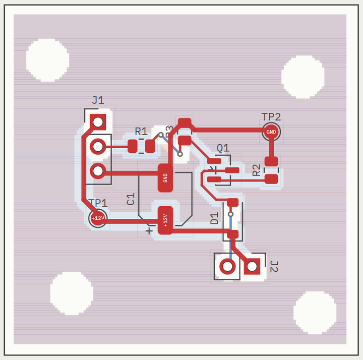
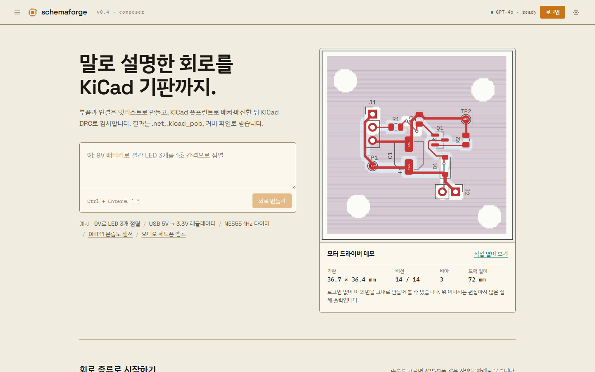
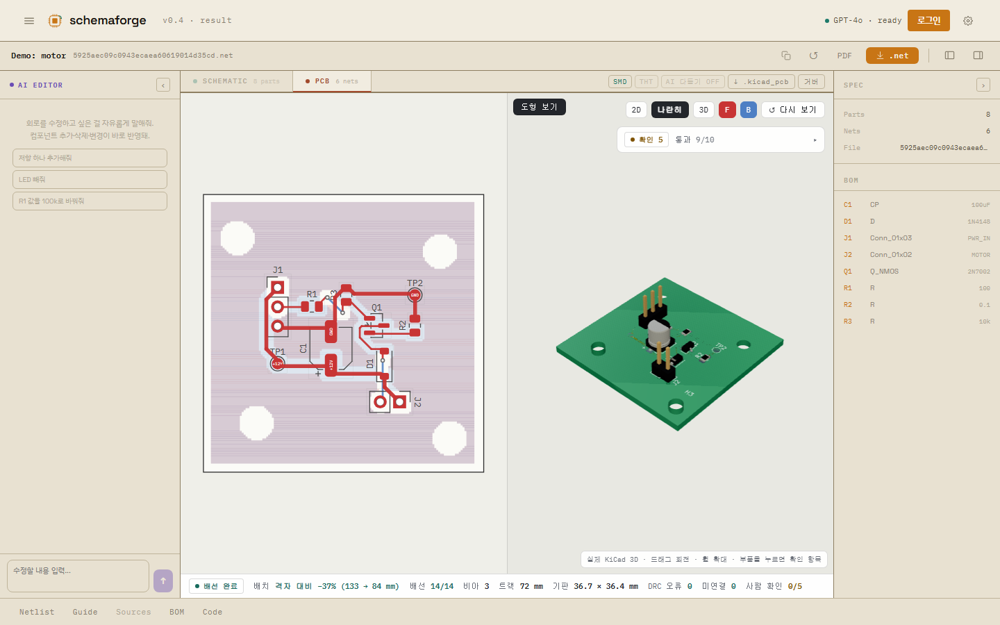
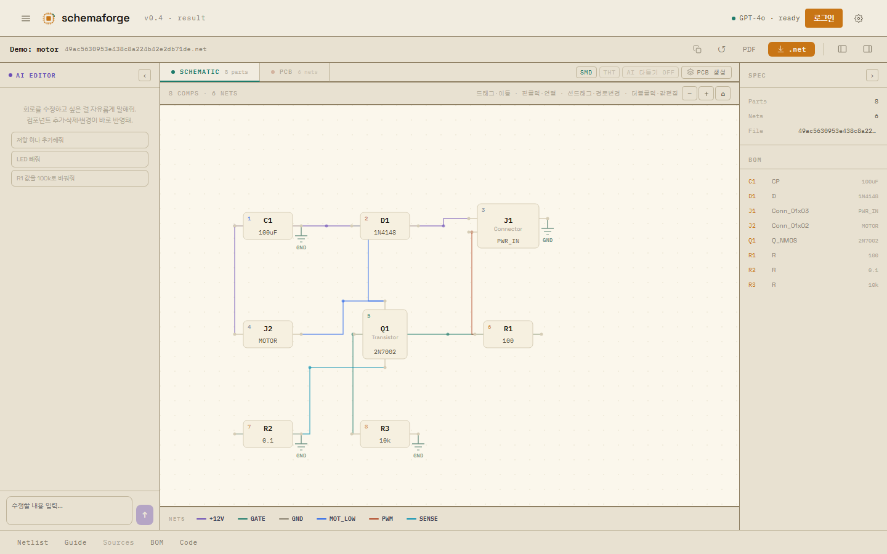
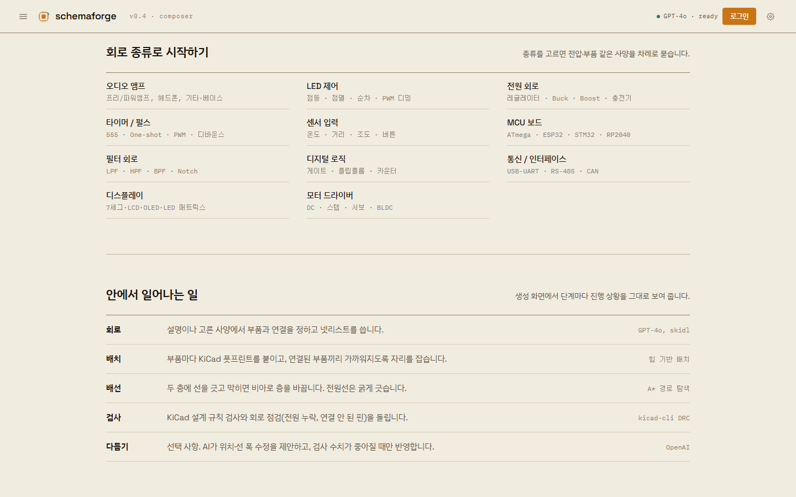
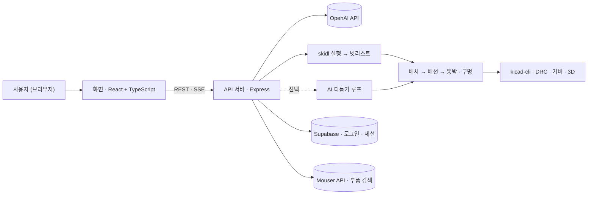

# SchemaForge

회로를 말로 설명하면 넷리스트·회로도·2층 PCB를 만들고, KiCad 설계 규칙 검사(DRC)까지 돌려서 `.net`, `.kicad_pcb`, 거버 파일로 내보내는 웹 앱.



위 이미지는 편집하지 않은 실제 출력이다. 저장소에 들어 있는 모터 드라이버 데모 회로(`server/test_circuits/nmos_motor.py`)를 돌린 결과로, 기판 36.7 × 36.4 mm, 배선 14/14 완료, 비아 3개, 트랙 길이 72 mm, KiCad DRC 오류 0이다. OpenAI 키 없이 `/?demo=motor`에서 같은 결과를 만들 수 있다.

## 프로젝트 개요

### 배경
간단한 회로 하나를 기판으로 만들려 해도 회로도 작성 → 부품마다 풋프린트 고르기 → 배치 → 배선 → 설계 규칙 검사 → 거버 출력까지 KiCad 같은 전문 도구를 거쳐야 한다. 처음 배우는 사람에게는 도구 사용법이 회로보다 먼저 벽이 된다. 생성형 AI로 회로 코드를 만드는 것은 가능하지만, AI가 만든 결과를 그대로 기판으로 만들면 핀이 끊기거나 규칙을 어긴 기판이 나와도 알아채기 어렵다.

### 목표
- 말로 설명한 회로를 **제조에 쓸 수 있는 파일**(`.net`, `.kicad_pcb`, 거버)까지 한 화면에서 만든다
- AI가 만든 결과를 **검사로 확인한 뒤에만** 다음 단계로 넘긴다 — 회로는 실행과 회로 점검, 기판은 KiCad DRC
- 배치·배선이 계산되는 과정을 그대로 보여 줘, 결과가 어떻게 나왔는지 사용자가 따라갈 수 있게 한다

### 대상 사용자
- 회로 기초를 배우는 학생·입문자 — 아이디어를 기판까지 빠르게 확인하고 싶은 사람
- 작은 실험용 기판(LED, 타이머, 센서, 모터 구동)을 자주 만드는 메이커

### 주요 기능
| 기능 | 내용 |
|---|---|
| 말로 회로 만들기 | 한 줄 설명 또는 회로 종류(11종)에서 시작. 빠진 사양은 질문으로 채우고, 설계 계획을 확인한 뒤 생성 |
| 회로도와 대화형 수정 | 생성된 회로를 회로도로 보여 주고 "저항 추가", "R1 값을 100k로"처럼 말로 고친다 |
| 자동 배치·배선 | 실제 KiCad 풋프린트로 부품을 놓고(힘 기반 배치) 2층에 선을 긋는다(A* 경로 탐색). SMD·THT 선택 |
| 검사 | KiCad DRC + 회로 점검(전원 누락, 연결 안 된 핀). 결과를 숫자로 표시 |
| 2D · 3D 보기 | KiCad 색 2D와 KiCad가 내보낸 3D 모델을 나란히 |
| AI 기판 다듬기 (선택) | AI가 배치·선 굵기 수정을 제안하고, 검사 점수가 좋아질 때만 반영 |
| 내보내기 · 부품 | `.net`, `.kicad_pcb`, 거버 내려받기, 부품 목록(BOM: 같은 부품을 묶은 수량·패키지, CSV)과 Mouser 부품 검색 |

### 화면
| 홈 — 설명 입력 | 결과 — 기판 2D · 3D |
|---|---|
|  |  |
| **결과 — 회로도와 AI 편집기** | **홈 — 회로 종류와 단계 안내** |
|  |  |

### 시스템 구조


### 기술 스택
| 영역 | 사용 기술 |
|---|---|
| 화면 | React 19, TypeScript, Vite, SCSS, three.js |
| 서버 | Node.js, Express 5, TypeScript (tsx) |
| AI | OpenAI GPT-4o (회로 코드 생성), GPT-4o mini (사양 질문 · 계획 · 대화형 수정) |
| 회로 · 기판 | Python, skidl, 직접 구현한 배치(힘 기반) · 배선(A*) · 회로 점검 |
| 검사 · 출력 | KiCad 10 `kicad-cli` (DRC, 거버, 3D 모델) |
| 저장 · 인증 | Supabase |
| 배포 · CI | Docker (공식 KiCad 이미지 기반), Railway, GitHub Actions (린트 · 타입 · 빌드) |

### 일정과 계획
시스템 구조 상세, 화면 설명, AI 활용방안, 주 단위 일정은 [docs/project-plan.md](docs/project-plan.md)에 있다.

## 무엇을 하나

| 단계 | 하는 일 | 쓰는 것 |
|---|---|---|
| 회로 | 설명에서 부품과 연결을 정하고 skidl 코드를 실행해 넷리스트를 만든다. 넷리스트 점검(연결 안 된 핀 등)에서 오류가 나오면 모델이 한 번 고치고, 고친 코드가 실행되며 오류가 줄 때만 받아들인다 | GPT-4o, skidl, `server/erc_repair.ts` |
| 배치 | 부품마다 KiCad 풋프린트를 붙이고, 연결된 부품이 가까워지도록 자리를 잡는다 | 힘 기반 배치 (`server/pcb/placer.py`) |
| 배선 | 두 층에 트랙을 긋고, 막히면 비아로 층을 바꾼다. 전원 넷은 굵게 긋는다 | A* 경로 탐색 (`server/pcb/router.py`) |
| 마감 | GND 동박(pour), 고정 구멍 4개, 전원 넷 테스트 포인트를 넣는다 | `server/pcb/board.py` |
| 검사 | KiCad DRC와 회로 점검(전원 누락, 연결 안 된 핀)을 돌린다 | `kicad-cli`, `server/pcb/erc.py` |
| 다듬기 | 선택 사항. 모델이 배치·선 굵기 수정을 제안하고, **검사 수치가 좋아질 때만** 반영한다 | `server/ai_layout.ts` |

화면에서는 배치와 배선 과정을 그대로 재생하고, 완성된 기판은 2D(KiCad 색)와 3D(KiCad가 내보낸 GLB 모델)로 나란히 본다. **배치하기** 탭에서는 실물 기판에 부품을 올리면서 KiCad 3D 모델의 부품을 눌러 체크한다(평면 그림으로도 볼 수 있다). 옆 목록은 같은 부품끼리 묶고 진행률을 보여 주며, 목록에 마우스를 올리면 그 부품 자리가 빛난다. LED·전해 커패시터·555처럼 방향이 있는 부품은 처음 누르면 기판 위 정확한 패드에 +, −, 1 표시를 띄우고 실물에서 무엇을 보면 되는지 쉬운 말로 알려 준 뒤, '맞췄어요'를 눌러야 체크된다. 체크는 기판마다 이 브라우저에 남는다.

### AI 다듬기가 동작하는 방식

모델은 **제안만** 하고, 적용과 판정은 코드가 한다.

1. 기판 상태(부품 위치, 넷별 굵기, 지표, DRC 위반)를 모델에게 준다.
2. 모델이 이동·회전·선 굵기 변경을 제안한다.
3. 제안을 **선 폭 묶음 → 배치 묶음**으로 나눠, 묶음마다 따로 적용한다.
4. 묶음마다 겹침 사전 검사 → 재배선 → DRC → 점수 비교.
5. **나빠지거나 그대로면 되돌린다.** 좋아진 묶음만 남는다.

점수 순서: DRC 오류 → 미배선 → 겹침·기판 밖 → 디커플링 커패시터 거리 → 좁은 전원선 개수 → 선 길이 → 비아 → 트랙 길이.

### 동작 검사 — 그 회로가 실제로 동작하는가

DRC와 회로 점검은 "연결이 이어져 있는가"까지만 본다. 동작 검사는 부품 값으로 계산해서 "값이 맞아 실제로 동작하는가"를 본다. 회로도 단계(PCB 생성 전)와 완성된 기판의 검사 목록에 같은 결과가 나온다. PCB 생성은 막지 않는다.

| 규칙 | 계산 |
|---|---|
| 전원 전압 | 배터리(직렬이면 순서와 상관없이 더함)와 레귤레이터 출력을 먼저 정하고 넷 이름은 그다음에 본다. 직렬 다이오드(역극성 보호)를 지나면 순방향 전압만큼 낮아질 수 있는 범위로 넘기고, 거꾸로 단 직렬 다이오드 뒤의 레일에는 전원이 없다. 이름과 실제 전압이 다르거나, 배터리가 거꾸로이거나, 단자가 떠 있거나, 전압이 다른 배터리가 병렬이거나, GND가 배터리와 이어져 있지 않으면 안 됨. 배터리 값에서 전압을 읽지 못하면(예: `2xAA`, `CR2032`) 판단 불가 |
| 전원 단락 | 스위치를 누르거나 릴레이 접점이 붙을 때 서로 다른 전원이 바로 이어지는지, 두 전원 사이에 다이오드가 순방향으로 걸리는지 |
| LED 전류 | (전원 − 순방향 전압 합) ÷ 직렬 저항, 최대 전류와 비교. 직렬 LED, 저항 하나를 나눠 쓰는 병렬 LED(스위치로 꺼지는 LED가 있으면 가장 큰 전류는 남은 LED만 켜졌을 때로), 트랜지스터 뒤의 LED까지 계산. 방향이 거꾸로인지, 저항이 없는지(0 Ω 포함) |
| 보호 다이오드 | 릴레이 코일·모터 양단에 있는지, 캐소드가 전원 쪽인지(코일 전원보다 낮은 레일이면 꺼져도 전류가 흐르므로 안 됨), 역전압·전류 정격 |
| 릴레이 코일 전압 | 전원 − 스위치가 보장하는 최대 전압 강하가 동작 전압(정격의 75%) 이상인지, 허용 최대(130%) 이하인지. 거꾸로 단 보호 다이오드가 코일을 묶는지 |
| 트랜지스터 켜짐 | NPN: IC/IB 조건을 만족하면 VCE(sat) 행, 아니면 최소 hFE 행(VCE 1 V)으로 켜짐을 판단. 베이스에 저항이 없거나, 풀다운만 있거나, 저항 반대쪽이 떠 있으면 안 됨. MOSFET: 게이트 전압이 켜짐 저항 보장 전압 이상인지, 게이트 최대 20 V 미만인지 |
| 스위치 전류 한계 | 부하 전류가 IC·ID 최대값 이하인지, 전원이 VCEO(NPN)·VDSS(MOSFET) 미만인지. 모터 전류와 정격 전압은 값에 적힌 것(예: `MOTOR 5V 0.3A`)을 읽고, 정격보다 높은 전압이 걸리면 안 됨(전류는 전압에 비례한다고 어림). 부하 전원이 0 V 이하면 안 됨. MOSFET 게이트는 부하로 세지 않음 |
| 저항 발열 | LED·컬렉터 부하·베이스와 게이트 저항·전원 사이 저항·555 출력에 달린 저항·모터와 직렬인 저항·555 타이밍 저항의 전력이 정격 이하인지. 비안정 555의 RA는 VCC가 걸리는 방전 구간 비율 RB ÷ (RA + 2RB)로 평균을 낸다 |
| 극성 커패시터 방향 | 전해 커패시터의 + 단자가 − 단자보다 높은지 |
| 555 타이머 | 전원 4.5~16 V, GND·RESET·CTRL·DISCH 배선, 출력(3번 핀)이 전원·GND에 바로 묶였는지, 비안정 구성이면 f = 1.44 ÷ ((RA + 2RB) × C) (병렬 저항·커패시터 합성), RA + RB 최대값은 VCC에 따라 |
| 레귤레이터 전압 | 입력 − 출력이 최소 전압 차 이상인지, 최대 입력, 출력 커패시터, 출력 단락·입출력 바뀜·우회 |

- 계산 방향을 질문에 맞춘다. "전류가 너무 큰가"는 가장 작은 전압 강하(트랜지스터 0 V, 555 출력 강하 0 V, 직렬 다이오드 0 V, 코일 저항 −10%)로, "동작하는가"는 데이터시트가 보장하는 가장 큰 강하(감지 저항 강하, 직렬 다이오드 순방향 전압 최대 포함)로 계산한다. 555 출력이 받아 내리는 LED는 LOW 전압(VOL) 자료가 없어 가장 큰 전류만 계산한다. 절대 최대 정격은 같은 값이면 안 됨, 90% 이상이면 경고다.
- 스위치는 눌린(닫힌) 상태로, 릴레이는 붙은 상태(COM–NO 닫힘, NC 열림)로 계산한다. LED 직렬 경로도 닫힌 스위치·접점을 지나 이어 간다. 다만 릴레이 코일(붙는지, 보호 다이오드)은 자기 접점이 붙기 전 상태로 계산하고(자기 접점으로만 전원을 받는 코일은 붙지 못한다), 코일 핀이 비어 있는 릴레이는 붙지 않는 것으로 본다. 닫힌 접점이 레귤레이터 출력에 다른 전원을 이으면 출력 전압을 바꾸지 않고 단락으로 본다. 저항으로 끌어올린 넷을 GND로 내리는 버튼(555 리셋 버튼 등)은 입력으로 보고 버튼을 놓았을 때 동작하는지를 본다. 풀업 없이 GND로만 내리는 리셋 버튼은 놓으면 핀이 떠 있으므로 경고다.
- 결과는 **동작함 / 경고 / 안 됨 / 판단 불가** 네 가지다. 커넥터로 들어오는 전원이나 모터 전류처럼 계산에 필요한 값을 모르면 통과로 처리하지 않고 판단 불가로 둔다. 신호 전압을 모르면 3.3 V와 5 V 두 경우를 계산해 보여 준다. 머리글은 한 원인에서 이어진 실패를 한 번만 세고, 판단 불가 개수를 함께 보여 준다. 릴레이는 모두 놓인 상태(COM–NC 닫힘, COM–NO 열림)에서 시작해 실제로 붙는 릴레이만 바꿔 가며 계산한다(서로를 붙잡기만 하는 래치는 시작하지 않는다). 붙는 릴레이의 NC 쪽은 놓여 있을 때로 따로 본다. 붙지 않는 릴레이 접점에 기대는 판정은 그 릴레이를 원인으로 묶고, 접점이 닫혀도 남는 오류는 따로 센다. 트랜지스터 구동 실패는 LED를 정격 전류로 바꿔도 실패할 때만 트랜지스터 자체의 문제로 센다.
- 핀 대응 정보(`pad_pins`)가 없는 예전 보드는 핀을 구분할 수 없어 동작 검사를 하지 않고 판단 불가 한 줄만 낸다.
- 한계값은 모두 제조사 데이터시트에서 읽고 출처를 함께 적었다 (`src/lib/partSpecs.ts`: Kingbright LED, Vishay 1N4148·1N4007, onsemi 1N5819, onsemi 2N3904·MMBT3904·BC547·2N7002·2N7000, TI NE555·LM7805, AMS1117, Sanyou SRD 릴레이, Yageo 저항). 결과 화면에서 각 판정을 펼치면 계산식과 출처가 보인다.
- 되는 회로와 안 되는 회로를 한 쌍씩 넣어 두었다. 키 없이 비교할 수 있다: `/?demo=led` ↔ `/?demo=led_bad` (저항 680 Ω → 10 Ω), `/?demo=relay` ↔ `/?demo=relay_bad` (보호 다이오드 반대 방향), `/?demo=ne555` ↔ `/?demo=ne555_bad` (전원 9 V → 3 V).

## 필요한 것

- Node.js, Python (개발·검사 환경: Node 24.14, Python 3.14)
- **KiCad** — DRC, 거버, 3D 모델 내보내기에 `kicad-cli`가 필요하다 (확인한 버전 10.0.6). 없어도 기판 생성과 화면 표시는 되지만 검사·내보내기는 꺼진다 (`/health`가 어느 쪽인지 알려 준다)
- OpenAI API 키 — 회로 생성과 AI 다듬기에 쓴다. 없으면 내장 데모 회로 4개로만 돌린다

## 실행

```bash
npm install
pip install -r requirements.txt
cd server && npm install && cd ..
```

`server/.env`에 키를 넣는다 (`.env`는 커밋하지 않는다).

```
OPENAI_API_KEY=...
SUPABASE_URL=...            # 로그인·세션 저장 (없으면 메모리에만 저장)
SUPABASE_SERVICE_KEY=...
MOUSER_API_KEY=...          # 부품 가격·재고 조회 (선택. 없으면 BOM에 줄마다 검색 링크만 보인다)
KICAD_CLI_PATH=...          # kicad-cli가 PATH에 없을 때
```

```bash
npm run dev      # 화면(vite 3000) + API(8080) 동시 실행
```

`http://localhost:3000` 접속. 키 없이 보려면 `http://localhost:3000/?demo=motor` (다른 데모: `led`, `ne555`, `relay`, 일부러 망가뜨린 `led_bad`, `ne555_bad`, `relay_bad`).

### 그 밖의 환경 변수

| 변수 | 쓰임 |
|---|---|
| `PORT` | API 포트 (기본 8080) |
| `SF_AI_MODEL` | AI 다듬기에 쓸 모델 이름 |
| `SF_AI_JSON=1` | function calling 대신 JSON 응답으로 받기 (게이트웨이가 도구 호출을 지원하지 않을 때) |
| `SF_AI_STUB=1` | 모델 대신 고정된 제안을 쓰는 검사용 모드 |
| `OPENAI_BASE_URL` | OpenAI 호환 게이트웨이 주소 |

## 검사

```bash
python server/pcb/run_checks.py
```
테스트 회로 4개를 SMD·THT 두 방식으로, 즉 기판 8개를 만들어 각각 19항목을 확인한다 (풋프린트 매핑, 패드 좌표가 KiCad와 같은지, 극성, 코트야드 겹침, DRC, 거버, 배선 완료, 회로 점검, PCB 전 넷리스트 점검이 기판 점검과 같은지 등). 여기에 더해 일부러 망가뜨린 회로(`broken_floating.py`)를 잡아내는지, 풋프린트 표가 맞는지도 확인한다.

```bash
cd server && npx tsx check_ai_layout.ts
```
AI 다듬기의 판정 규칙 13항목 (사전 검사, 점수 순서, 릴레이 접점·모터 경로의 부하 전류 넷 판정 등). 모델을 호출하지 않는다.

```bash
cd server && npx tsx check_erc_repair.ts
```
넷리스트 점검(ERC) 자동 수정 20항목. 고친 코드가 실행되고 오류가 줄어들 때만 받아들이는지(부품을 지우거나 값을 바꾸거나 맞게 이어져 있던 핀을 옮기면 거절), 점검이 돌지 못하면 통과로 세지 않는지, 생성 프롬프트에 LED 색·555 핀 규칙이 있는지, skidl 실행 환경에 키가 들어가지 않고 임시 폴더가 지워지며 오류 출력에 색 코드가 섞이지 않는지, 코드 실행(`/test_code`)에 로그인이 필요한지, 핀 이름 표가 화면 쪽과 같은지. 모델을 호출하지 않는다 (python과 skidl 필요).

```bash
cd server && npx tsx check_deploy_guard.ts
```
배포 서버(`NODE_ENV=production`)가 막는 것 9항목. `ALLOWED_EMAILS`에 있고 가입 확인을 마친 계정만 회로 생성·AI 편집·코드 실행을 쓰는지, 비밀번호를 보지 않는 개발용 로그인이 꺼지는지, 요청에서 받은 파일 이름이 `outputs` 밖으로 나가지 않는지. 마지막 항목은 서버를 배포 모드로 직접 띄워 데모는 열리고 나머지는 거절되는지 확인한다 (python과 skidl 필요).

```bash
python server/pcb/check_deploy.py
```
배포 이미지 7항목 (Docker 필요, `npm test`에는 넣지 않음). 이미지를 빌드해 띄운 뒤 컨테이너 안 KiCad 10, 이미지에 `.env`가 없는지, 기판·DRC·거버, 실행 경로, 3D 모델에 부품 몸체가 들어가는지(KiCad 이미지에는 3D 모델이 없어 `server/pcb/3dmodels` 사본을 쓴다), 배포 서버 차단을 확인한다.

```bash
cd server && SF_AI_STUB=1 PORT=8098 npx tsx index.ts     # 다른 터미널에서
python server/pcb/check_ai_loop.py --port 8098
```
고정 배치 재현성과 다듬기 루프 6항목. 나쁜 제안이 되돌려지는지, 섞인 제안에서 좋은 쪽만 남는지 확인한다.

```bash
npx tsx scripts/check_operating.ts
```
동작 검사 184항목. 한 군데만 다른 되는/안 되는 회로 쌍, 손으로 계산한 값과의 일치, 부품표의 출처, 회로도와 기판의 판정 일치, 데모 회로 파일(skidl 실행), 검토에서 나온 오판 사례 140건(회로마다 하나씩), 부품을 거꾸로 나열해도 같은 답이 나오는지를 확인한다.

```bash
npx tsx scripts/check_code_view.ts
```
Code 탭 87항목. 코드 강조가 원문을 바꾸지 않는지, 오류 출력에서 사용자 코드의 줄 번호를 찾는지(skidl 내부 줄은 건너뛰고, 색 코드가 섞인 출력도 읽음), 들여쓰기, 실제 python에 오류를 넣었을 때의 줄 번호, 글자색 대비.

```bash
npx tsx scripts/check_bom.ts
```
BOM 26항목. 같은 템플릿·값·풋프린트 묶기(핀 헤더는 넷 이름이 달라도 한 줄), 기판 풋프린트와의 대조(회로가 바뀐 부품은 비움), 테스트 패드·고정 구멍 분리, CSV 이스케이프, 검색 링크(www.mouser.kr), 가격 형식(소수점 쉼표는 읽지 않음), 지어낸 Mouser 부품 번호·가격이 없는지. 앱에서 만든 기판(`server/outputs`)이 없으면 그 기판들로 하는 2항목은 건너뛴다고 표시하고 통과로 세지 않는다.

```bash
npx tsx scripts/check_assembly.ts
```
배치하기 15항목. 올릴 부품 목록(테스트 패드·고정 구멍 제외), 저장이 막히거나 깨져도 동작하는지, 기판마다 따로 저장(같은 넷리스트를 THT로 다시 만들면 새로 시작), 기판 파일이 있으면 3D로 열리고 2D를 고른 브라우저는 평면 그림으로 여는지, 평면 그림이 기판 파일의 실제 위치로 그려지고 부품마다 누를 자리가 있는지, 방향 보기 단추, 방향 확인 전 부품은 첫 클릭에 체크하지 않고 맞췄어요가 한 번에 체크·확인하는지, PCB 화면의 AI 다듬기 기록이 접혀 있고 건너뛴 경우에는 펼쳐 보이는지.

```bash
npx tsx scripts/check_human_review.ts
```
방향 확인 29항목. 방향을 묻는 부품(극성·1번 다리·다리 순서·커넥터)만 고르는지, 핀 이름이 서버 부품 템플릿과 같은지, +·−·1 표시가 생성기가 배선한 패드에 붙는지(다이오드 캐소드, 전해 커패시터 +, MOSFET 다리 순서), 부품을 돌려도 표시가 그 패드에 가는지, 설명이 SMD·THT에 맞고 패드 번호를 쓰지 않는지(IC 1번 다리, 트랜지스터·레귤레이터를 꽂는 방향 포함), 부품 이름 뒤 조사, 확인 기록 저장. 앱에서 만든 기판(`server/outputs`)이 없으면 그 기판들로 하는 항목은 건너뛴다고 표시하고 통과로 세지 않는다.

```bash
npx tsx scripts/check_fixes.ts
```
경고 해결책 22항목. AI가 선 이름을 빼먹어도 적은 핀이 이미 있는 선으로 합치는지, 이미 연결돼 있던 핀을 옮기면 알리는지, 정답을 모르는 해결 문장은 짐작하지 말고 묻게 하는지, AI 편집이 핀을 이름으로 적어도(K, −, p2) 번호로 받는지, 해결책마다 AI 편집에 넣을 문장이 있는지, AI 편집의 선 연결이 같은 이름의 기존 선에 합쳐지는지(핀 하나짜리 선을 새로 만들지 않음), Code 탭에 넣는 고칠 줄의 위치, 555 RESET은 VCC 핀과 같은 선으로, 끊긴 LED K와 한 핀짜리 GND는 하나의 해결책으로(기판 패드가 아닌 기호 핀 번호), 같은 부품 양끝은 제안하지 않음, LED 저항 추천값을 동작 검사로 다시 확인(SMD 470 Ω, THT 270 Ω, 전류만 보고 고른 330 Ω은 발열로 걸러짐), 핀 배열 경고의 다시 만들 방식, 모터 데모 경고의 해결 문구. 고칠 줄은 skidl·ERC·자동 수정 판정으로 따로 돌려 확인했다.

```bash
npx tsc --noEmit             # 화면 타입 검사
cd server && npm run typecheck
npm run lint
```

## 구조

```
src/                  화면 (React + TypeScript)
  components/
    FormComposer      홈: 설명 입력, 회로 종류 선택
    WizardPanel       생성 중 화면 (서버 단계·기록)
    ClarifyPanel      빠진 사양을 묻는 화면
    PlanPanel         설계 계획 확인 화면
    ResultPanel       결과 화면 틀 (좌우 패널·아래 탭)
    CircuitCanvas     회로도
    BoardView         기판 2D + 배치·배선 재생, 검사 목록, 배치하기(3D·2D에서 부품 체크)
    KiCad3DViewer     KiCad GLB 모델 3D 보기 (three.js) · 부품 고르기, 패드 위 +·−·1 표시
    OperatingPanel    회로도 단계의 동작 검사 결과
  lib/
    operatingCheck    동작 검사 (부품 값으로 계산)
    partSpecs         데이터시트 한계값과 출처
    boardChecks       검사 목록 행 만들기
    humanReview       방향 확인 항목 (초보자용 설명, 패드 위 표시)
    fixes             경고 옆 해결책 (ERC 연결, LED 저항값, 핀 배열 다시 만들기)
server/
  index.ts            API, 스트리밍 생성, KiCad 호출
  ai_layout.ts        AI 다듬기: 제안 나누기·적용·점수
  pcb/
    board.py          기판 만들기 (배치 → 배선 → 동박 → 구멍 → 저장)
    placer.py         힘 기반 배치
    router.py         A* 배선
    erc.py            회로 점검
    footprints/       벤더 풋프린트 사본
  test_circuits/      검사·데모용 회로 8개 (되는/안 되는 회로 쌍 포함)
dev/board.html        기판 화면만 따로 띄우는 개발용 페이지
```

## 알려진 제약

- 2층 기판만 만든다. 기판 외형은 직사각형 고정.
- **데모 기판을 그대로 제작하지 마세요.** 릴레이 데모의 `Q1=2N3904`는 SMD 선택 시 MMBT3904용 패드 배열(1=B, 2=E, 3=C)로, 모터 데모의 `Q1=2N7002`는 THT 선택 시 2N7000용 배열(1=S, 2=G, 3=D)로 배선됩니다. 선택한 실제 부품과 기판의 핀 배열을 반드시 대조하세요. [2N3904/MMBT3904 데이터시트](https://www.onsemi.com/download/data-sheet/pdf/pzt3904-d.pdf), [2N7000/2N7002 데이터시트](https://www.onsemi.com/download/data-sheet/pdf/nds7002a-d.pdf).
- 모터 데모 주석의 2 A는 **검증된 구동 정격이 아닙니다.** 위 onsemi 데이터시트의 2N7002 연속 드레인 전류 최대값은 115 mA, 2N7000은 200 mA로, 2 A 부하에 사용할 수 없습니다. MOSFET·저항·다이오드·커넥터를 실제 모터 전류에 맞춰 재선정해야 합니다.
- 동작 검사는 전원·LED·보호 다이오드·릴레이·트랜지스터(로우사이드 NPN·N-MOSFET)·저항 발열·전해 커패시터·555·레귤레이터만 계산한다. 하이사이드 스위치, 555 방전 핀 전류와 출력 LOW 전압(한계값을 아직 확인하지 못함), 커패시터 내압은 보지 않는다. 그 밖의 부품 값(필터 커패시터 용량 등)과 555 주파수가 요청한 값과 맞는지는 보지 않으니 제작 전에 직접 검토해야 한다. 7805 외의 78xx 레귤레이터와 빨강이 아닌 LED는 데이터시트 수치를 아직 넣지 않아 판단 불가로 나온다.
- 배선은 격자 기반이라 트랙 각도가 제한된다.
- AI 다듬기는 한 번 돌 때마다 OpenAI 호출 비용이 든다. 기본은 꺼져 있다.

## 배포

Railway + Supabase 기준 순서는 [DEPLOY.md](DEPLOY.md) 참고. 컨테이너에 KiCad가 없으면 DRC·거버·3D가 비활성화된다.
