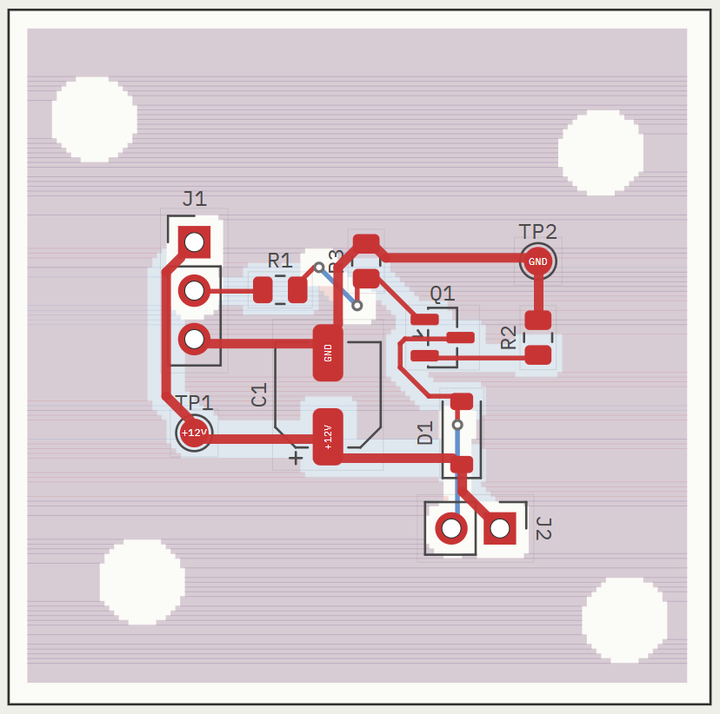
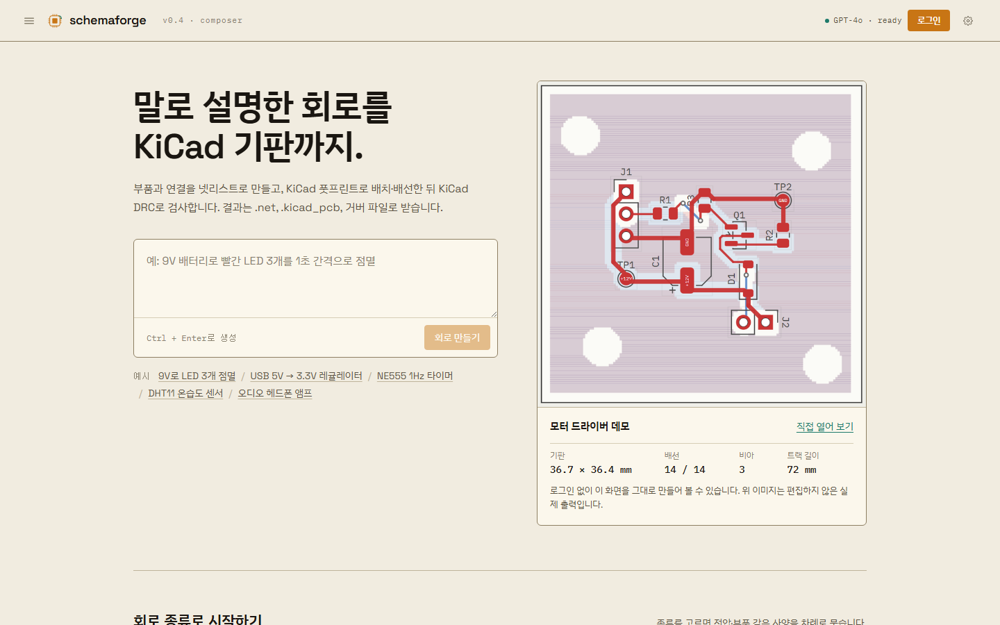
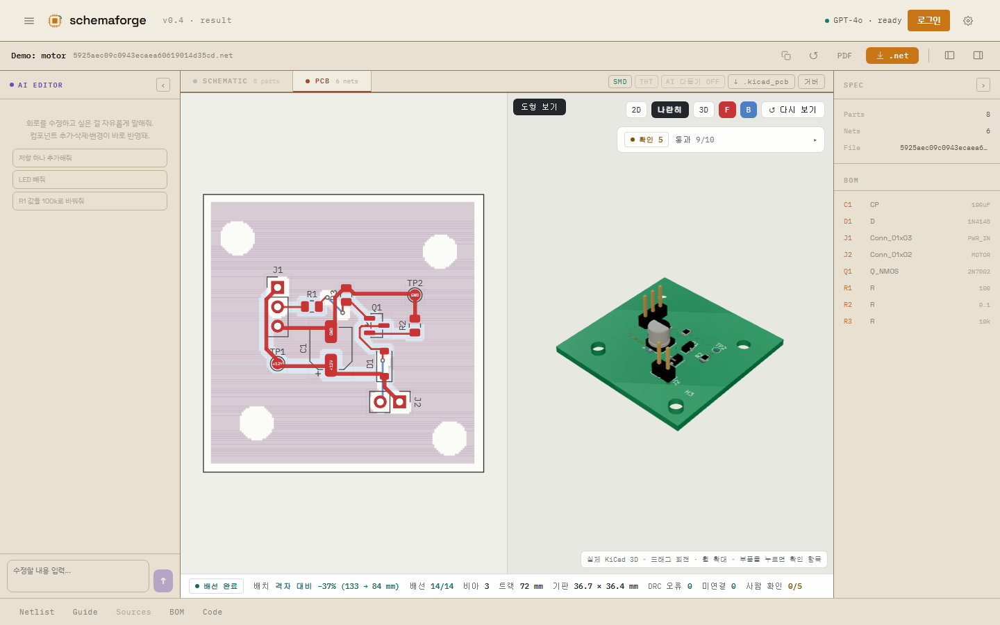
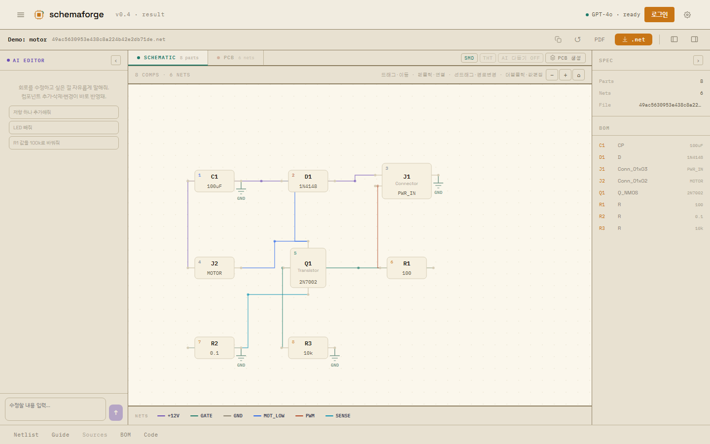
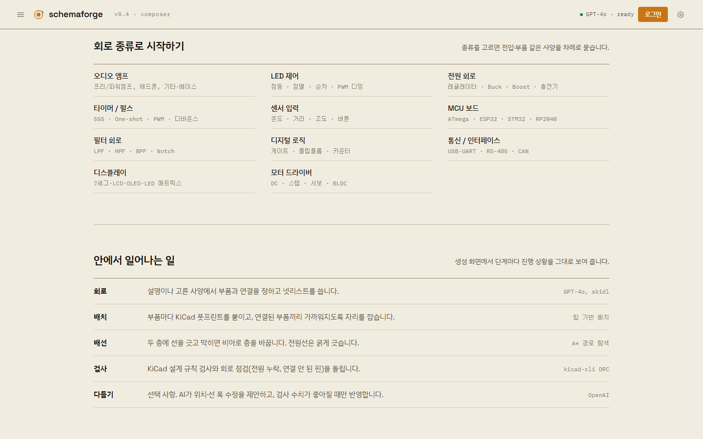
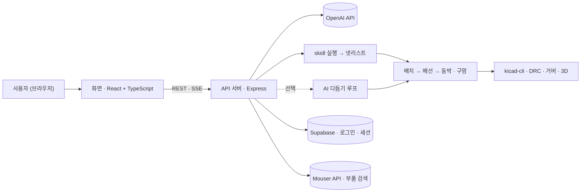

# SchemaForge

회로를 말로 설명하면 넷리스트·회로도·2층 PCB를 만들고, KiCad 설계 규칙 검사(DRC)까지 돌려서 `.net`, `.kicad_pcb`, 거버 파일로 내보내는 웹 앱.



위 이미지는 편집하지 않은 실제 출력이다. 저장소에 들어 있는 모터 드라이버 데모 회로(`server/test_circuits/nmos_motor.py`)를 돌린 결과로, 기판 36.7 × 36.4 mm, 배선 14/14 완료, 비아 3개, 트랙 길이 72 mm, KiCad DRC 오류 0이다. OpenAI 키 없이 `/?demo=motor`에서 같은 결과를 만들 수 있다.

배포 데모: https://schemaforge-app.duckdns.org/?demo=motor (집의 젯슨 서버, DEPLOY.md 7절). 예전 주소 https://schemaforge.kro.kr (Render 무료 인스턴스, 기본 주소 https://schemaforge-zuco.onrender.com 과 같은 서버)도 같은 코드로 남아 있는데, 15분 동안 아무도 쓰지 않으면 잠들어서 첫 접속에 약 1분 걸린다. 데모 기판 하나(넷리스트 → 기판·DRC)는 젯슨에서 2초, Render에서 6~9초 걸렸다(2026-11-08, `check_live.mjs` P2).

## 프로젝트 개요

### 배경
간단한 회로 하나를 기판으로 만들려 해도 회로도 작성 → 부품마다 풋프린트 고르기 → 배치 → 배선 → 설계 규칙 검사 → 거버 출력까지 KiCad 같은 전문 도구를 거쳐야 한다. 처음 배우는 사람에게는 도구 사용법이 회로보다 먼저 벽이 된다. 생성형 AI로 회로 코드를 만드는 것은 가능하지만, AI가 만든 결과를 그대로 기판으로 만들면 핀이 끊기거나 규칙을 어긴 기판이 나와도 알아채기 어렵다.

### 목표
- 말로 설명한 회로를 **제조에 쓸 수 있는 파일**(`.net`, `.kicad_pcb`, 거버)까지 한 화면에서 만든다
- AI가 만든 결과를 **검사로 확인한 뒤에만** 다음 단계로 넘긴다 — 회로는 실행과 회로 점검, 기판은 KiCad DRC
- 배치·배선이 계산되는 과정을 그대로 보여 줘, 결과가 어떻게 나왔는지 사용자가 따라갈 수 있게 한다

### 대상 사용자
- 회로 기초를 배우는 학생·입문자 — 아이디어를 기판까지 빠르게 확인하고 싶은 사람
- 작은 실험용 기판(LED, 타이머, 센서, 모터 구동)을 자주 만드는 메이커

### 주요 기능
| 기능 | 내용 |
|---|---|
| 말로 회로 만들기 | 한 줄 설명 또는 회로 종류(11종)에서 시작. 빠진 사양은 질문으로 채우고, 설계 계획을 확인한 뒤 생성 |
| 회로도와 대화형 수정 | 생성된 회로를 회로도로 보여 주고 "저항 추가", "R1 값을 100k로"처럼 말로 고친다. 요청에 이름이 없는 부품은 지우거나 값·연결을 바꾸지 못하게 막고, 고친 뒤에는 바뀐 연결선 수를 알려 준다 |
| 자동 배치·배선 | 실제 KiCad 풋프린트로 부품을 놓고(힘 기반 배치) 2층에 선을 긋는다(A* 경로 탐색). SMD·THT 선택 |
| 검사 | KiCad DRC + 회로 점검(전원 누락, 연결 안 된 핀, IC 전원 핀 옆 커패시터, 서로 이어지지 않은 두 접지). 결과를 숫자로 표시. DRC 줄을 펼치면 어떤 규칙으로 검사했는지와 앱 배선 규칙의 숫자를 제조사(JLCPCB) 최소값·출처·읽은 날과 함께 보여 준다. 회로도 단계에서는 안전 경고도 낸다: 모터·릴레이 역기전력 보호 다이오드, 전원 역접속 보호, 모터 비상정지 스위치 |
| 2D · 3D 보기 | KiCad 색 2D와 KiCad가 내보낸 3D 모델을 나란히 |
| AI 기판 다듬기 (선택) | AI가 배치·선 굵기 수정을 제안하고, 검사 점수가 좋아질 때만 반영 |
| 내보내기 · 부품 | `.net`, `.kicad_pcb`, 거버 zip(PCB 업체에 그대로 올리는 7개 층 + 도금·비도금 드릴, GND 동박 포함), 부품 목록(BOM: 같은 부품을 묶은 수량·패키지, CSV)과 Mouser 부품 검색. 측정표(기판의 테스트 포인트 위치와 전원을 켰을 때 나와야 하는 전압, 사람용 CSV·측정 장치용 JSON). 실제 주문·조립 순서는 [docs/fabrication-guide.md](docs/fabrication-guide.md) |

### 화면
| 홈 — 설명 입력 | 결과 — 기판 2D · 3D |
|---|---|
|  |  |
| **결과 — 회로도와 AI 편집기** | **홈 — 회로 종류와 단계 안내** |
|  |  |

### 시스템 구조


### 기술 스택
| 영역 | 사용 기술 |
|---|---|
| 화면 | React 19, TypeScript, Vite, SCSS, three.js |
| 서버 | Node.js, Express 5, TypeScript (tsx) |
| AI | OpenAI GPT-4o (회로 코드 생성), GPT-4o mini (사양 질문 · 계획 · 대화형 수정) |
| 회로 · 기판 | Python, skidl, 직접 구현한 배치(힘 기반) · 배선(A*) · 회로 점검 |
| 검사 · 출력 | KiCad 10 `kicad-cli` (DRC, 거버, 3D 모델) |
| 저장 · 인증 | Supabase |
| 배포 · CI | Docker (공식 KiCad 이미지 기반), Render (무료 인스턴스), GitHub Actions (린트 · 타입 · 빌드 · 모델·KiCad·python 없이 도는 검사 6개: 스타일시트, `npm test` 목록, 버전 고정, API 클라이언트, 배치하기, outputs 정리) |

### 일정과 계획
시스템 구조 상세, 화면 설명, AI 활용방안, 주 단위 일정은 [docs/project-plan.md](docs/project-plan.md)에 있다.

## 무엇을 하나

| 단계 | 하는 일 | 쓰는 것 |
|---|---|---|
| 회로 | 설명에서 부품과 연결을 정하고 skidl 코드를 실행해 넷리스트를 만든다. 넷리스트 점검(연결 안 된 핀 등)에서 오류가 나오면 모델이 한 번 고치고, 고친 코드가 실행되며 오류가 줄 때만 받아들인다 | GPT-4o, skidl, `server/erc_repair.ts` |
| 배치 | 부품마다 KiCad 풋프린트를 붙이고, 연결된 부품이 가까워지도록 자리를 잡는다 | 힘 기반 배치 (`server/pcb/placer.py`) |
| 배선 | 두 층에 트랙을 긋고, 막히면 비아로 층을 바꾼다. 전원 넷은 굵게 긋는다 | A* 경로 탐색 (`server/pcb/router.py`) |
| 마감 | GND 동박(pour), 고정 구멍 4개, 전원 넷 테스트 포인트를 넣는다 | `server/pcb/board.py` |
| 검사 | KiCad DRC와 회로 점검(전원 누락, 연결 안 된 핀)을 돌린다 | `kicad-cli`, `server/pcb/erc.py` |
| 다듬기 | 선택 사항. 모델이 배치·선 굵기 수정을 제안하고, **검사 수치가 좋아질 때만** 반영한다 | `server/ai_layout.ts` |

화면에서는 배치와 배선 과정을 그대로 재생하고, 완성된 기판은 2D(KiCad 색)와 3D(KiCad가 내보낸 GLB 모델)로 나란히 본다. **배치하기** 탭에서는 실물 기판에 부품을 올리면서 KiCad 3D 모델의 부품을 눌러 체크한다(평면 그림으로도 볼 수 있다). 옆 목록은 같은 부품끼리 묶고 진행률을 보여 주며, 목록에 마우스를 올리면 그 부품 자리가 빛난다. LED·전해 커패시터·555처럼 방향이 있는 부품은 처음 누르면 기판 위 정확한 패드에 +, −, 1 표시를 띄우고 실물에서 무엇을 보면 되는지 쉬운 말로 알려 준 뒤, '맞췄어요'를 눌러야 체크된다. 체크는 기판마다 이 브라우저에 남는다.

### AI 다듬기가 동작하는 방식

모델은 **제안만** 하고, 적용과 판정은 코드가 한다.

1. 기판 상태(부품 위치, 넷별 굵기, 지표, DRC 위반)를 모델에게 준다.
2. 모델이 이동·회전·선 굵기 변경을 제안한다.
3. 제안을 **선 폭 묶음 → 배치 묶음**으로 나눠, 묶음마다 따로 적용한다.
4. 묶음마다 겹침 사전 검사 → 재배선 → DRC → 점수 비교.
5. **나빠지거나 그대로면 되돌린다.** 좋아진 묶음만 남는다.

점수 순서: DRC 오류 → 미배선 → 겹침·기판 밖 → 디커플링 커패시터 거리(1 mm 이상 변하면 그것으로 판정, 소수 1자리로 보이게 늘면 거절) → 좁은 전원선 개수 → 선 길이(HPWL, 0.1 mm) → 비아 → 트랙 길이(0.1 mm) → 보이게 준 디커플링.

### 설계 원칙 — AI는 제안하고, 한계는 코드와 하드웨어가 지킨다

SchemaForge 전체가 같은 원칙으로 나뉘어 있다. AI(언어 모델)는 회로 코드와 배치 수정을 **제안**만 한다. 받아들일지, 되돌릴지, 통과인지는 정해진 코드(회로 실행, 회로 점검, 동작 검사, KiCad DRC, 위의 점수 비교)가 정한다. AI가 아무리 그럴듯하게 답해도 검사를 통과하지 못하면 다음 단계로 가지 않는다.

같은 생각을 만들어질 회로에도 적용한다. 회로 검사는 모터가 배터리까지 스위치 없이 이어져 있으면 "모터 비상정지 스위치가 없습니다"를 경고한다. 모터를 켜고 끄는 판단은 프로그램(마이크로컨트롤러)이 하더라도, 프로그램이 멈추거나 트랜지스터가 켜진 채 고장 나면 판단이 소용없다. 그때 모터를 멈추는 것은 사람이 누르는 스위치, 곧 하드웨어여야 한다. 전원 역접속 보호(전원을 거꾸로 꽂아도 직렬 다이오드가 막아 준다)도 같은 이유로 경고한다.

2026 창의적 종합설계 경진대회 본선(2026-11-13)에 나온 액체 자동 충진기 팀도 같은 구조를 썼다. 카메라와 비전 처리(젯슨)는 얼마나 내려가고 얼마나 채울지 측정·판단만 하고, 내려가는 한계와 비상정지는 마이크로컨트롤러 펌웨어와 하드 스톱(기구로 막는 멈춤 장치)이 최종 책임을 진다고 발표했다.

### 동작 검사 — 그 회로가 실제로 동작하는가

DRC와 회로 점검은 "연결이 이어져 있는가"까지만 본다. 동작 검사는 부품 값으로 계산해서 "값이 맞아 실제로 동작하는가"를 본다. 회로도 단계(PCB 생성 전)와 완성된 기판의 검사 목록에 같은 결과가 나온다. PCB 생성은 막지 않는다.

| 규칙 | 계산 |
|---|---|
| 전원 전압 | 배터리(직렬이면 순서와 상관없이 더함)와 레귤레이터 출력을 먼저 정하고 넷 이름은 그다음에 본다. 직렬 다이오드(역극성 보호)를 지나면 순방향 전압만큼 낮아질 수 있는 범위로 넘기고, 거꾸로 단 직렬 다이오드 뒤의 레일에는 전원이 없다. 이름과 실제 전압이 다르거나, 배터리가 거꾸로이거나, 단자가 떠 있거나, 전압이 다른 배터리가 병렬이거나, GND가 배터리와 이어져 있지 않으면 안 됨. 배터리 값에서 전압을 읽지 못하면(예: `2xAA`, `CR2032`) 판단 불가. 리튬이온 배터리(`4S`, `3S1P LiPo`, `7.4V Li-ion`, `11.1V 리튬`)는 셀 수를 읽어, 전압이 적혀 있지 않으면 셀당 공칭 3.6 V로 계산하고 완전히 충전한 전압(셀당 4.2 V, Panasonic NCR18650B·Murata US18650VTC6 데이터시트)도 함께 넘긴다 |
| 전원 단락 | 스위치를 누르거나 릴레이 접점이 붙을 때 서로 다른 전원이 바로 이어지는지, 두 전원 사이에 다이오드가 순방향으로 걸리는지 |
| LED 전류 | (전원 − 순방향 전압 합) ÷ 직렬 저항, 최대 전류와 비교. 직렬 LED, 저항 하나를 나눠 쓰는 병렬 LED(스위치로 꺼지는 LED가 있으면 가장 큰 전류는 남은 LED만 켜졌을 때로), 트랜지스터 뒤의 LED까지 계산. 방향이 거꾸로인지, 저항이 없는지(0 Ω 포함) |
| 보호 다이오드 | 릴레이 코일·모터 양단에 있는지, 캐소드가 전원 쪽인지(코일 전원보다 낮은 레일이면 꺼져도 전류가 흐르므로 안 됨), 역전압·전류 정격 |
| 릴레이 코일 전압 | 전원 − 스위치가 보장하는 최대 전압 강하가 동작 전압(정격의 75%) 이상인지, 허용 최대(130%) 이하인지. 거꾸로 단 보호 다이오드가 코일을 묶는지 |
| 트랜지스터 켜짐 | NPN: IC/IB 조건을 만족하면 VCE(sat) 행, 아니면 최소 hFE 행(VCE 1 V)으로 켜짐을 판단. 베이스에 저항이 없거나, 풀다운만 있거나, 저항 반대쪽이 떠 있으면 안 됨. MOSFET: 게이트 전압이 켜짐 저항 보장 전압 이상인지, 게이트 최대 정격(20 V, IRLZ44N은 16 V) 미만인지. 소스 아래 감지 저항이 있는데 부하 전류를 모르면 강하 0과 가장 큰 전류(ID 최대, 부하 전원 ÷ 감지 저항이 더 작으면 그 값) 두 끝을 계산해, 신호 하나라도 판정이 갈리면 판단 불가로 두고 어느 전류까지 켜지는지 적는다. 강하 0 쪽은 전류가 조금이라도 흐를 때로 보므로, 게이트가 보장 전압이나 문턱과 딱 같으면 못 미치는 것으로 센다. 게이트 풀다운이 없으면 부하 전류를 몰라도 경고한다. 감지 저항 강하가 구동 전압보다 커지는 계산은 음수 대신 0 V 이하로 적는다 |
| 스위치 전류 한계 | 부하 전류가 IC·ID 최대값 이하인지, 전원이 VCEO(NPN)·VDSS(MOSFET) 미만인지. 모터 전류와 정격 전압은 값에 적힌 것(예: `MOTOR 5V 0.3A`)을 읽고, 정격보다 높은 전압이 걸리면 안 됨(전류는 전압에 비례한다고 어림). 부하 전원이 0 V 이하면 안 됨. MOSFET 게이트는 부하로 세지 않음. IRFZ44N·IRLZ44N의 ID 최대는 케이스를 25 °C로 유지할 때의 값이라, 켜짐 저항 발열(I² × 게이트 전압에서 보장되는 RDS(on) 행 × 175 °C에서 커지는 배수, 데이터시트 그래프를 두 번 읽은 값 중 큰 쪽)이 방열판 없이 견디는 (175 − 25) °C ÷ RθJA 62 °C/W = 2.42 W의 90% 이상이면 경고(방열판은 계산하지 않음), 케이스를 25 °C로 유지할 때의 최대 손실(PD) 이상이면 안 됨. RDS(on) 행은 게이트 전압 이하에서 보장된 것 중 가장 작은 값(IRLZ44N: 10 V 22 mΩ, 5 V 25 mΩ, 4 V 35 mΩ)이고, 게이트가 가장 낮은 보장 전압보다 낮으면 켜짐 저항을 몰라 판단 불가(트랜지스터 켜짐 결과에서 이어진 것으로 머리글에 한 번만 셈) |
| 저항 발열 | LED·컬렉터 부하·베이스와 게이트 저항·이미터/소스 아래 전류 감지 저항·전원 사이 저항·555 출력에 달린 저항·모터와 직렬인 저항·555 타이밍 저항의 전력이 정격 이하인지. 감지 저항은 부하 전류(NPN은 베이스 전류도)로 P = I² × R, 부하 전류를 모르면 트랜지스터 정격 전류(부하 전원 ÷ 감지 저항이 더 작으면 그 값)로 계산하고, 그래도 정격의 90% 미만이면 통과, NPN 베이스 전류만으로 90% 이상이면 경고나 안 됨, 그 밖에는 판단 불가로 두고 어느 전류 미만이면 되는지 적는다. 비안정 555의 RA는 VCC가 걸리는 방전 구간 비율 RB ÷ (RA + 2RB)로 평균을 낸다 |
| 극성 커패시터 방향 | 전해 커패시터의 + 단자가 − 단자보다 높은지 |
| 555 타이머 | 전원 4.5~16 V, GND·RESET·CTRL·DISCH 배선, 출력(3번 핀)이 전원·GND에 바로 묶였는지, 비안정 구성이면 f = 1.44 ÷ ((RA + 2RB) × C) (병렬 저항·커패시터 합성), RA + RB 최대값은 VCC에 따라 |
| 레귤레이터 전압 | 입력 − 출력이 최소 전압 차 이상인지, 최대 입력(리튬이온 배터리면 완전히 충전한 전압으로도: 4S 16.8 V는 AMS1117의 15 V를 넘어 안 됨), 출력 커패시터, 출력 단락·입출력 바뀜·우회 |

- 계산 방향을 질문에 맞춘다. "전류가 너무 큰가"는 가장 작은 전압 강하(트랜지스터 0 V, 555 출력 강하 0 V, 직렬 다이오드 0 V, 코일 저항 −10%)로, "동작하는가"는 데이터시트가 보장하는 가장 큰 강하(감지 저항 강하, 직렬 다이오드 순방향 전압 최대 포함)로 계산한다. 555 출력이 받아 내리는 LED는 LOW 전압(VOL) 자료가 없어 가장 큰 전류만 계산한다. 절대 최대 정격은 같은 값이면 안 됨, 90% 이상이면 경고다.
- 스위치는 눌린(닫힌) 상태로, 릴레이는 붙은 상태(COM–NO 닫힘, NC 열림)로 계산한다. LED 직렬 경로도 닫힌 스위치·접점을 지나 이어 간다. 다만 릴레이 코일(붙는지, 보호 다이오드)은 자기 접점이 붙기 전 상태로 계산하고(자기 접점으로만 전원을 받는 코일은 붙지 못한다), 코일 핀이 비어 있는 릴레이는 붙지 않는 것으로 본다. 닫힌 접점이 레귤레이터 출력에 다른 전원을 이으면 출력 전압을 바꾸지 않고 단락으로 본다. 저항으로 끌어올린 넷을 GND로 내리는 버튼(555 리셋 버튼 등)은 입력으로 보고 버튼을 놓았을 때 동작하는지를 본다. 풀업 없이 GND로만 내리는 리셋 버튼은 놓으면 핀이 떠 있으므로 경고다.
- 결과는 **동작함 / 경고 / 안 됨 / 판단 불가** 네 가지다. 커넥터로 들어오는 전원이나 모터 전류처럼 계산에 필요한 값을 모르면 통과로 처리하지 않고 판단 불가로 둔다. 신호 전압을 모르면 3.3 V와 5 V 두 경우를 계산해 보여 준다. MCU는 커넥터로만 들어오므로, 게이트·베이스를 구동하는 커넥터의 값이 보드나 칩, 전압을 밝히면(ESP32·ESP8266·STM32·RP2040·Pico·3V3은 3.3 V, Arduino Uno·Nano·Mega·ATmega328·5V는 5 V, Nano ESP32·Nano 33·Jetson Nano처럼 칩이 3.3 V면 3.3 V) 그 전압 하나로 계산하고 판정 근거에 어느 커넥터 값에서 왔는지 적는다. 신호가 지나는 넷 이름에 VCC_3V3·3V3_OUT처럼 3.3 V만 적혀 있으면 보드 이름보다 그 전압을 먼저 쓴다. 넷 이름의 5V(PWM_5V 등)는 부하의 전압일 때가 많아 신호 전압을 올리는 데 쓰지 않는다. 보드 없이 ATmega328 칩만 적힌 값은 3.3 V로도 도는 칩이라, 같은 커넥터의 전원 핀이 모두 3.3 V나 5 V 하나로 알려져 있으면 그 전압으로, 그 밖에는(전원 핀이 없을 때도) 두 경우를 계산한다. Uno·Nano·Mega는 보드 이름 그대로일 때만 5 V로 읽는다(앞에 Arduino, 뒤에 R3·2560 같은 판 번호나 D9 같은 핀 이름만). UNO Q·Nano Matter·Orin Nano처럼 다른 낱말이 붙으면 3.3 V 보드일 수 있어 두 경우를 계산한다. 전원 커넥터(PWR)와 두 전압을 다 적은 값은 신호로 읽지 않는다. 5V·3V3처럼 적힌 전압은 그 커넥터의 다른 핀이 GND가 아닌 넷 중 전압을 아는 넷, 이름이 전원인 넷(+5V 등), 또는 트랜지스터의 베이스·게이트(바로나 저항 하나를 거쳐) 말고 다른 것(부하, 다른 전원 핀)에 이어진 넷에 있거나(넷 이름이 VM·V+여도) 값에 VIN·USB 같은 전원 낱말이 있으면 전원의 전압이라 신호로 읽지 않는다. 머리글은 한 원인에서 이어진 실패를 한 번만 세고, 판단 불가 개수를 함께 보여 준다. 회로 검사에 오류(끊긴 연결 등)가 있으면 이어진 부분만 통과한 것이라 머리글은 통과 대신 '판단 불가 · 회로 오류'로 보인다. 릴레이는 모두 놓인 상태(COM–NC 닫힘, COM–NO 열림)에서 시작해 실제로 붙는 릴레이만 바꿔 가며 계산한다(서로를 붙잡기만 하는 래치는 시작하지 않는다). 붙는 릴레이의 NC 쪽은 놓여 있을 때로 따로 본다. 붙지 않는 릴레이 접점에 기대는 판정은 그 릴레이를 원인으로 묶고, 접점이 닫혀도 남는 오류는 따로 센다. 트랜지스터 구동 실패는 LED를 정격 전류로 바꿔도 실패할 때만 트랜지스터 자체의 문제로 센다.
- 핀 대응 정보(`pad_pins`)가 없는 예전 보드는 핀을 구분할 수 없어 동작 검사를 하지 않고 판단 불가 한 줄만 낸다.
- 한계값은 모두 제조사 데이터시트에서 읽고 출처를 함께 적었다 (`src/lib/partSpecs.ts`: Kingbright LED, Vishay 1N4148·1N4007, onsemi 1N5819, onsemi 2N3904·MMBT3904·BC547·2N7002·2N7000, Infineon IRFZ44N·IRLZ44N, TI NE555·LM7805, AMS1117, Sanyou SRD 릴레이, Yageo 저항). 결과 화면에서 각 판정을 펼치면 계산식과 출처가 보인다.
- 되는 회로와 안 되는 회로를 한 쌍씩 넣어 두었다. 키 없이 비교할 수 있다: `/?demo=led` ↔ `/?demo=led_bad` (저항 680 Ω → 10 Ω), `/?demo=relay` ↔ `/?demo=relay_bad` (보호 다이오드 반대 방향), `/?demo=ne555` ↔ `/?demo=ne555_bad` (전원 9 V → 3 V).

## 필요한 것

- Node.js, Python (개발·검사 환경: Node 24.14, Python 3.14)
- **KiCad** — DRC, 거버, 3D 모델 내보내기에 `kicad-cli`가 필요하다 (확인한 버전 10.0.6). 없어도 기판 생성과 화면 표시는 되지만 검사·내보내기는 꺼진다 (`/health`가 어느 쪽인지 알려 준다)
- OpenAI API 키 — 회로 생성과 AI 다듬기에 쓴다. 없으면 내장 데모 회로 4개로만 돌린다

## 실행

```bash
npm install
pip install -r requirements.txt
cd server && npm install && cd ..
```

`server/.env`에 키를 넣는다 (`.env`는 커밋하지 않는다).

```
OPENAI_API_KEY=...
SUPABASE_URL=...            # 로그인·세션 저장 (없으면 메모리에만 저장)
SUPABASE_SERVICE_KEY=...
MOUSER_API_KEY=...          # 부품 가격·재고 조회 (선택. 없으면 BOM에 줄마다 검색 링크만 보인다)
KICAD_CLI_PATH=...          # kicad-cli가 PATH에 없을 때
```

```bash
npm run dev      # 화면(vite 3000) + API(8113) 동시 실행
```

Windows는 포트를 100개씩 묶어 자기 몫으로 잡아 둘 수 있고(Hyper-V·WSL, 재부팅하면 바뀔 수 있다), 그 안의 포트는 `EACCES`로 열리지 않는다. 개발 PC에서 8080과 8002가 그랬다(7989-8088). API가 `Cannot listen on port`로 끝나면 `netsh interface ipv4 show excludedportrange protocol=tcp`로 범위를 보고, 그 밖의 포트를 `server/.env`의 `PORT`에 적는다.

`http://localhost:3000` 접속. 키 없이 보려면 `http://localhost:3000/?demo=motor` (다른 데모: `led`, `ne555`, `relay`, 일부러 망가뜨린 `led_bad`, `ne555_bad`, `relay_bad`).

### 그 밖의 환경 변수

| 변수 | 쓰임 |
|---|---|
| `PORT` | API 포트 (기본 8113, vite 프록시도 이 값을 따른다. 배포 이미지는 8002) |
| `OPENAI_BASE_URL` | OpenAI 호환 API 주소. 모든 모델 호출이 이 주소로 간다 (예: xAI Grok `https://api.x.ai/v1`, 키는 `OPENAI_API_KEY`에) |
| `SF_MODEL` | 회로 코드와 ERC 자동 수정에 쓸 모델 (기본 `gpt-4o`). 화면 위쪽과 생성 단계에 이 이름이 나온다 |
| `SF_MODEL_MINI` | 되묻기·설계 계획·AI 편집에 쓸 모델 (기본 `gpt-4o-mini`) |
| `SF_REASONING_EFFORT` | 모든 모델 호출에 `reasoning_effort`로 보낸다. 추론형 모델은 추론 토큰이 답 길이 한도를 먹으니 `grok-4.3`이면 `none` |
| `SF_AI_MODEL` | AI 다듬기에 쓸 모델 이름 (기본 `SF_MODEL_MINI`) |
| `SF_AI_JSON=1` | function calling 대신 JSON 응답으로 받기 (게이트웨이가 도구 호출을 지원하지 않을 때) |
| `SF_AI_STUB=1` | 모델 대신 고정된 제안을 쓰는 검사용 모드 |
| `SF_AI_STUB_MODE=fail2` | `SF_AI_STUB=1`과 함께 쓰면 2라운드의 모델 호출이 실패한다 (429나 깨진 JSON처럼). 검사용 (`check_ai_loop.py`) |
| `SF_AI_BUDGET_MS` | 기판을 만든 뒤 DRC와 AI 다듬기 라운드에 쓰는 시간 한도, ms (기본 420000 = 7분). 넘으면 지금까지 채택한 기판으로 끝낸다. 검사가 짧게 줄인다 |
| `SF_JOB_SLOTS` | 무거운 작업(기판 생성·AI 다듬기 라운드의 재배선과 DRC·3D 모델·거버·회로 점검)을 한 번에 몇 개까지 돌릴지 (기본 4). 나머지는 16개까지 줄을 서고, 줄이 차거나 60초 넘게 기다리면 503과 "잠시 뒤에 다시 눌러 주세요" 안내를 받는다. 한 방문자(주소 하나, IPv6는 앞 64비트)는 2개까지 돌고 4개까지 기다린다. `/health`의 `jobs`가 지금 도는 수·기다리는 수·자리 수를 알려 준다 |
| `SF_CODE_FIX_MS` | 실행되지 않은 회로 코드를 모델이 고쳐 보내는 시간 한도, ms (기본 45000). 넘으면 오류 상자에 그렇게 알린다. 검사가 짧게 줄인다 (`check_model_config.ts` L9c) |

## 검사

`npm test`가 아래 검사 중 모델 없이 도는 것을 모두 차례로 돌린다 (깨끗한 체크아웃에서 대략 8분, KiCad 필요). 앞 검사가 실패하면 거기서 멈춘다. 브라우저로 화면을 쓰는 검사(`npm run test:browser`가 따로 돌린다), 배포 이미지 검사(Docker), 배포된 서버 검사는 넣지 않는다. 어느 검사가 어느 쪽인지는 `scripts/check_test_chain.ts`가 목록으로 지킨다. 기판을 읽는 검사가 쓰는 검사용 기판은 `scripts/make_check_boards.ts`가 데모 회로 4개를 SMD·THT로 만들어 `server/outputs/`에 기판마다 그 넷리스트와 함께 둔다(없거나 생성기보다 오래됐을 때만).

```bash
python server/pcb/run_checks.py
```
테스트 회로 5개를 SMD·THT 두 방식으로, 즉 기판 10개를 만들어 각각 20항목을 확인한다 (풋프린트 매핑, 패드 좌표가 KiCad와 같은지, 극성, 코트야드 겹침, GND 동박을 채운 DRC, 거버, 배선 완료, 회로 점검, PCB 전 넷리스트 점검이 기판 점검과 같은지, 트랜지스터와 브리지 정류기의 다리가 데이터시트 배열의 패드에 가는지 등). 거버는 서버와 같은 `server/pcb/fab_export.py`로 만들고, zip에 7개 층과 드릴 2개만 들었는지, 드릴이 도금·비도금으로 나뉘었는지, 동박이 거버에 들어갔는지, 동박이 다른 구리에서 0.5 mm 떨어지는지 본다. 여기에 더해 일부러 망가뜨린 회로(`broken_floating.py`)를 잡아내는지, 555 데모에서 VCC의 100 nF 커패시터를 뺀 회로가 두 방식 모두 `no_bypass` 경고 하나를 받는지, 두 전원의 접지(GND·AGND)를 잇지 않은 회로가 `split_ground` 경고를 받고 0 Ω 저항이나 페라이트(L)로 이은 회로는 받지 않는지(10 kΩ으로는 이어진 것으로 보지 않는다), 다리 4개를 2핀 다이오드로 적은 브리지 정류기를 조용히 놓지 않고 다리마다 보고하는지, 표에 없는 부품의 아주 큰 핀 번호가 그 수만큼 패드를 만들지 않고 300 MB·30초 안에 경고로 끝나는지, 회로도에 핀 이름(A·K, B·C·E, COIL1, p1)으로 저장된 넷리스트가 핀 이름 표로 읽혀 번호로 저장된 것과 같은 패드·경고·넷리스트 점검이 나오고 표에 없는 이름은 짐작하지 않고 경고로 보고하는지, 배치 국소 탐색의 후보 비용이 `hpwl`과 같이 움직이고 후보마다 파이썬 호출을 하지 않으며 제일 싼 빈 자리를 고르는지, 풋프린트 표가 맞는지도 확인한다.

```bash
cd server && npx tsx check_ai_layout.ts
```
AI 다듬기의 판정 규칙 20항목 (사전 검사와 그 불합격을 화면에 한국어로 적는지, 점수 순서, 릴레이 접점·모터 경로의 부하 전류 넷 판정(값이 자기 기호와 같은 저항, 즉 값 없이 넷리스트에 기호로 쓰인 저항은 션트로 보지 않음), 선 길이·트랙 길이를 목록에 찍히는 0.1 mm 단위로 비교하는지, 목록에 늘어 보이는 디커플링 손해는 받지 않는지 등). 모델을 호출하지 않는다.

```bash
cd server && npx tsx check_erc_repair.ts
```
넷리스트 점검(ERC) 자동 수정 28항목. 고친 코드가 실행되고 오류가 줄어들 때만 받아들이는지(부품을 지우거나 값을 바꾸거나 맞게 이어져 있던 핀을 옮기면 거절), 점검이 돌지 못하면 통과로 세지 않는지, 생성 프롬프트에 LED 색·555 핀 규칙이 있는지, skidl 실행 환경에 키가 들어가지 않고 임시 폴더가 지워지며 오류 출력에 색 코드가 섞이지 않는지, 코드 실행(`/test_code`)에 로그인이 필요한지, 핀 이름 표가 화면 쪽과 같은지, 생성 프롬프트가 모든 부품에 ref=를 주고 555의 CTRL을 자기 넷에 두라고 하는지(ref= 예시는 skidl로 실제로 돌려 본다), 그래프로 만든 넷리스트(pintype 없음)에서도 레귤레이터 출력을 공급원으로 보고 출력끼리 묶인 것을 잡으며 `erc.py`의 표가 부품 템플릿과 같은지, IC 전원 핀(`SUPPLY_PINS`: 템플릿의 PWRIN 핀에서 GND를 뺀 것)에 커패시터가 없으면 pintype이 있든 없든 같은 경고를 내는지. 모델을 호출하지 않는다 (python과 skidl 필요).

```bash
cd server && npx tsx check_deploy_guard.ts
```
배포 서버(`NODE_ENV=production`)가 막는 것 30항목(Windows가 아니면 29항목). `ALLOWED_EMAILS`에 있고 가입 확인을 마친 계정만 회로 생성·AI 편집·코드 실행을 쓰는지, 비밀번호를 보지 않는 개발용 로그인이 꺼지는지, 요청에서 받은 파일 이름이 `outputs` 밖으로 나가지 않는지, 서버 폴더가 점으로 시작하는 폴더(`.claude/worktrees/` 등) 아래에 있어도 넷리스트·기판·거버 내려받기와 화면 주소가 받히고 `outputs` 밖 이름과 점 파일은 그대로 404인지, `render.yaml`에 키 값이 없고 무료 플랜·헬스 체크 경로·포트가 맞는지, Windows가 잡아 둔 포트로 띄우면 그 범위를 보는 방법을 알리는지, 어느 폴더에 남은 빌드(`server/dist` 등)도 이미지와 lint에 들어가지 않는지. 서버를 배포 모드로 직접 띄워 데모는 열리고 나머지는 거절되는지, 부품이 하나도 없는 회로로 기판을 요청하면 파이썬 오류 대신 400과 한국어 문장이 오는지, 로그인하지 않은 방문자의 회로는 기판 요청과 넷리스트 복원 모두 부품 30개까지만 받고 31개는 파일을 쓰기 전에 바로 한국어로 거절하는지도 확인한다 (python과 skidl 필요). 서버가 띄우는 자식 프로세스(kicad-cli, 기판 생성기, 거버 내보내기)가 모두 키를 뺀 환경으로 시작하는지는 코드를 글로 읽어 본다. 기판 요청이 실패한 이유가 모두 할 일이 적힌 한국어 문장인지(영어나 파이썬 오류 출력이 화면으로 가지 않는지), 서버에 파일이 남아 있지 않은 기판·거버 요청이 그렇게 알리고 거버는 `board_gone`을 붙이는지도 본다. 배포 서버가 다른 사이트의 화면에 CORS 허용 헤더를 주지 않고 `FRONTEND_URL`이 있으면 그 주소에만 주는지, `/health`가 돌고 있는 커밋(`SF_COMMIT`, 없으면 Render의 `RENDER_GIT_COMMIT`)을 7자로 알려 주는지, 젯슨 이미지가 `scripts/jetson_run.sh`에서 빌드한 커밋을 `SF_COMMIT`으로 받는지(`Dockerfile.jetson`과 스크립트를 글로 읽는다)도 본다.

```bash
cd server && npx tsx check_job_slots.ts
```
무거운 작업 자리 13항목 (`server/job_slots.ts`). 서버 없이 규칙을 본다: 자리만큼만 돌고 나머지는 차례대로 기다리는지, 줄이 차면 바로 거절하는지, 돌려준 자리를 두 번 돌려줘도 한 자리인지, 오래 기다리거나 요청이 멈추면 줄에서 빠지는지, 한 방문자는 2개 돌고 4개 기다리며 그동안 다른 방문자가 먼저 들어가는지, IPv6 주소를 앞 64비트로 묶는지. 그다음 실제 서버를 배포 모드(`SF_JOB_SLOTS=3`)로 띄워 `/health`가 `jobs`를 주는지, 방문자 6명의 3D 내보내기 중 3개만 돌고 모두 온전히 오는지, 기다리는 기판 요청은 자리를 받은 뒤에야 넷리스트를 쓰는지, 줄이 차면 바로 503·`Retry-After`·한국어 문장으로 거절하고 파일을 남기지 않는지, 기다리는 동안 다른 창이 넘겨받은 요청이 409와 그 이유로 끝나는지, 한 방문자가 X-Forwarded-For 앞에 다른 주소를 적어도 2개 돌고 4개 기다리는지 확인한다 (python·skidl·KiCad 필요).

```bash
cd server && npx tsx check_auth_flow.ts
```
로그인과 기록 27항목. 가짜 Supabase(인증 서버와 표 API)를 띄우고 실제 서버를 배포 모드로 돌린다. 가입하면 확인 메일 안내만 오는지, 확인 전 로그인·이미 가입한 주소·잘못된 비밀번호·Supabase 중단(503)의 안내, 토큰 갱신과 만료(401 auth_expired), 허용 목록, 기록·대화·즐겨찾기의 주인 확인(남의 것은 404), 누가 로그인한 뒤에도 표 요청이 늘 서버 키로 나가는지, `/netlist/restore`, Supabase 없는 개발 모드, Mouser 가격 조회가 허용 목록 밖 계정을 키를 쓰기 전에 거절하고, 만료된 토큰에는 갱신하라는 401(auth_expired)로, Supabase 중단에는 503으로 답하는지, 배포 서버가 시작할 때와 `SF_SUPABASE_KEEPALIVE_HOURS`(기본 24시간, 0이면 끔)마다 표를 한 번 읽어 무료 프로젝트가 멈추지 않게 하는지를 확인한다.

```bash
cd server && npx tsx check_model_config.ts
```
모델 설정 23항목. 가짜 OpenAI 호환 API를 띄우고 실제 서버를 Grok처럼(`OPENAI_BASE_URL`, `SF_MODEL`, `SF_MODEL_MINI`, `SF_REASONING_EFFORT`) 설정한다. 회로 코드·되묻기·계획·AI 편집 호출이 모두 그 주소로 키·모델 이름·추론 설정을 가지고 가는지, 회로가 끝까지 만들어지는지, 승인한 설계 계획이 회로 요청에 들어가는지, AI 편집 프롬프트가 새 부품에 쓸 비어 있는 기호(C3가 있으면 C4)를 주고 요청에 없는 부품을 지우거나 값·연결을 바꾸지 말라고 하는지, 사용자에게 묻는 답이면 편집을 비우라고 하는지, 모델이 답 문장 없이 끝나거나 편집이 중간에 끊겨도 "완료했습니다"라고 하지 않는지(끊긴 편집은 적용하지 않고 나눠서 요청하라고 하며, 끊긴 답의 이스케이프는 제대로 읽음), `/health`가 화면에 보일 모델 이름과 이미지를 만든 커밋(`SF_COMMIT`)을 주는지, 설정이 없으면 GPT-4o·OpenAI인지 확인한다. 모델 크레딧이 떨어졌을 때(OpenAI 429 `insufficient_quota`) 계획·회로 생성·AI 편집이 상태 코드 대신 한국어로 알리는지(계획은 503), 질문 단계도 그런 실패는 알리고 다른 실패에는 질문 없이 넘어가는지, 요청이 몰렸을 때(429 `rate_limit_exceeded`) 잠시 뒤 다시 하라고 하는지, OpenAI SDK·axios·xAI가 주는 오류 모양을 모두 같은 안내로 읽는지, 계획 프롬프트에 부품 수 하한과 해당 없는 사양(주파수·효율)이 없고, 회로가 동작하는 데 필요한 부품(LED 직렬 저항, 555 타이밍 부품)은 빠뜨리지 않게 하는지도 본다. 모든 모델 호출이 60초 한도와 재시도 한 번의 같은 클라이언트를 쓰는지, 다시 해 볼 만한 실패는 한 번만 더 묻는지, 답하지 않거나 연결을 끊거나 연결을 받지 않는 모델을 OpenAI SDK와 axios 모두 한국어로 알리는지, 방문자가 떠나면 AI 편집의 모델 스트림이 끊기는지도 본다. 모델이 만든 회로 코드가 실행되지 않을 때(자동 재시도가 꺼져 있을 때, 고친 코드도 실행되지 않을 때, 고치는 호출이 `SF_CODE_FIX_MS` 안에 답하지 않을 때) 오류 상자가 "skidl execution error" 대신 무슨 일이 있었고 무엇을 하면 되는지 한국어로 말하는지도 본다.

```bash
cd server && npx tsx check_kicad_config.ts
```
개발 PC의 DRC 라이브러리 표 5항목 (KiCad와 python·skidl 필요). 개발 서버는 시작할 때 임시 폴더에 `server/pcb/footprints` 사본만 담은 풋프린트 라이브러리 표를 만들고, DRC만 이 표를 읽는다(`KICAD_CONFIG_HOME`, 배포 이미지와 같은 표. 이미 `KICAD_CONFIG_HOME`이 있으면 그것을 쓴다). 이 PC의 표는 설치된 KiCad 라이브러리 전체를 읽어 DRC 한 번이 대략 10초·1.4 GB였고, 이 표로는 대략 1초·160 MB에 같은 결과가 나왔다. 라이브러리 이름에 `.pretty`가 붙지 않는지, 데모 기판의 DRC에 `lib_footprint_issues`가 없는지, 그 DRC가 정말 이 표를 읽는지(표를 비우면 부품마다 `lib_footprint_issues`가 나오는지), `run_checks.py`가 같은 표를 만들어 자기 DRC에 주는지 확인한다. 3D와 거버 내보내기는 그대로다.

```bash
cd server && npx tsx check_inputs.ts
```
잘못된 요청에 서버가 하는 답 3항목. 개발 모드와 배포 모드 서버를 직접 띄워 요청을 보내고, 정해진 상태 코드(400·404·413)와 함께 한국어 문장이 JSON으로 오는지, 답 어디에도 스택이나 서버 경로가 없는지 본다. 깨진 JSON, 100 kB가 넘는 본문, 읽을 수 없는 %-이스케이프, 없는 주소를 보낸다(Express 기본 화면은 개발 모드에서 스택과 서버 경로를, 배포 모드에서 영어를 보였다). 본문을 읽는 주소마다 칸의 자료형이 틀리거나 빠진 요청(설명이 숫자, 회로가 글자, 이메일이 숫자, 부품 목록 61줄 등 24가지)에도 500이나 그대로 저장하는 대신 400과 한국어 문장으로 답하는지 본다. 모델·Supabase·Mouser는 부르지 않는다.

```bash
npx tsx scripts/check_api_client.ts
```
화면 쪽 API 클라이언트 42항목 (`src/api.ts`, 서버 없이 fetch를 흉내 낸다). 로그인 저장, 가입 응답, 401에서 한 번 갱신하고 다시 보내기(동시 요청은 갱신 한 번), 거절 코드, 즐겨찾기·대화 응답 모양, 모든 요청이 화면과 같은 주소로 가는지(빌드 설정으로 서버 주소를 바꾸지 않는다)를 확인한다. 개발 서버의 프록시(`vite.config.ts`)도 본다. vite는 경로가 처음으로 맞는 앞부분 하나로 보내므로, 어느 서버 경로도 먼저 닿지 않는 항목(`/generate` 뒤의 `/generate_gerber`)이 없고 모든 서버 경로에 항목이 있는지 확인한다. 개발 포트(프록시의 기본값, 서버 기본값, `.env.example`)가 하나이고 Windows가 잡아 둔 7989-8088 밖인지, 두 이미지가 내보내는 포트를 `PORT`로 정하는지도 본다. 미리보기 도구처럼 vite만 `PORT=3000`(vite 자기 포트)을 받고 떠도 프록시가 API 포트로 가는지는 `vite.config.ts`를 실제로 읽어 확인한다. 넷리스트 복원 요청에 저장된 로그인이 함께 가는지도 본다(방문자만 부품 30개 제한).

```bash
npx tsx scripts/check_pins.ts
```
버전 고정 7항목. `requirements.txt`의 모든 줄이 정확한 한 버전인지, 배포 이미지의 파이썬(젯슨 3.10, Render 3.13)마다 패키지가 한 번씩 깔리는지, 두 Dockerfile이 이 파일을 설치하는지, 루트의 tsx가 서버와 같은 버전인지, 서버가 선언한 패키지를 코드가 모두 쓰는지 확인한다. 이미지에 실제로 깔린 버전과의 대조는 `docker run --rm --entrypoint /venv/bin/pip <이미지> freeze`로 한다.

```bash
npx tsx scripts/check_styles.ts
```
스타일시트 7항목. `src/styles`의 부분 파일이 모두 `main.scss`에 들어 있고 어디서도 import하지 않는 `.css`가 없는지, `main.scss`가 컴파일되는지, 코드와 스타일시트가 이름으로 부르는 애니메이션마다 `@keyframes`가 있는지 확인한다(없으면 오류 없이 움직임만 멈춘다). 고정폭 글꼴 묶음이 시스템 글꼴보다 앞에 페이지가 불러오는 한글 웹 글꼴을 두는지도 본다(없으면 Windows가 고정폭 줄의 한글을 굴림체로 채운다). 글자 토큰(`fg`·`fg-muted`·`fg-dim`·`amber-deep`·`cyan-deep`·`violet`)이 다섯 면(`bg`~`bg-4`) 모두에서, 공용 버튼·칩·헤더 로그인·옆 서랍 기록 항목의 글자가 제 배경에서 대비 4.5:1 이상인지도 본다. `fg-faint`·`amber`·`cyan`은 선·채움·표시용이라 표에 넣지 않고, `danger`는 `bg-1`에서 4.24:1이라 색을 정할 때까지 빠져 있다. 브라우저 탭 아이콘(`public/favicon.svg`)이 헤더 로고(`Logo.tsx`)와 같은 칩 도형·같은 토큰 색인지(16 px에서 보이게 선을 굵게, 핀을 변마다 2개로 줄인 것은 허용), 옆 서랍도 그 로고를 쓰는지 본다. Google Fonts는 `index.html`의 `<link>` 한 번으로만 부르고(스타일시트의 `@import` 없음), 그 링크가 글꼴 묶음이 시스템 글꼴 앞에 적은 웹 글꼴을 모두 불러오는지도 본다.

```bash
npx tsx scripts/check_auth_modal.ts
```
로그인·가입 창 7항목 (`src/components/AuthModal.tsx`, 브라우저 없이). 이모지, 그라데이션·흐림, 토큰보다 큰 모서리(8 px 초과), 손으로 적은 글꼴 이름(한글이 IBM Plex Sans KR 대신 시스템 글꼴로 나온다), 영어 큰 제목과 근거 없는 최상급("가장 빠른")이 없는지 본다. 다른 화면은 2026-09-17에 이것들을 걷어냈는데 로그인 창만 남아 있었다. 열린 창이 제목으로 이름 붙은 `<dialog>`이고 닫기 버튼에 이름이 있으며 오류 상자가 `role="alert"`인지, 가입 화면에 이용약관·개인정보 처리방침 링크(새 탭)가 있는지도 본다.

```bash
npx tsx scripts/check_legal.ts
```
이용약관과 개인정보 처리방침 7항목 (`src/components/LegalPage.tsx`를 화면처럼 그려 읽는다, 브라우저 없이). 서버·화면 코드와 `index.html`·스타일시트가 부르는 바깥 주소마다 그 회사(Google 글꼴, OpenAI, Mouser, Supabase)가 방침에 있는지(표에 없는 새 주소는 방침과 표에 적을 때까지 실패), 파이프라인의 파이썬 파일이 바깥에 연결하지 않는지, 방침의 outputs 정리(15분마다, 24시간, 1 GB)가 서버 기본값과 같고 두 배포 이미지가 정리를 켜는지, 서버가 쓰는 Supabase 표가 모두 방침에 있는지, 방침이 말하는 기록 서랍의 전체 삭제와 그때 채팅·즐겨찾기도 지워지는 것(ON DELETE CASCADE)이 실제로 있는지, 두 문서가 이 저장소의 이슈로 링크하는지, 모델 회사 문장이 `/health`의 provider를 따르는지(로컬 모델이면 운영자의 컴퓨터, 답이 오기 전에는 기본값 OpenAI) 본다. 2026-09-17의 방침은 Google 글꼴을 적지 않고 "그 밖의 제3자에게 제공하지 않는다"고 했으며, 생성 파일이 남는다고만 적었다.

```bash
npx tsx scripts/check_test_chain.ts
```
`npm test` 목록 3항목. `scripts/`, `server/`, `server/pcb/`의 모든 `check_*` 파일이 `npm test`에 들어 있거나, 넣지 않는 이유(브라우저, Docker, 배포 이미지 안의 Linux)와 함께 목록에 적혀 있는지, 검사용 기판을 읽는 검사가 `make_check_boards.ts` 뒤에 도는지, `CLAUDE.md`와 `AGENTS.md`가 같은 글인지(줄 끝 CRLF·LF는 같게 본다) 확인한다. 동작 검사·기판 검사 목록·회로 검사가 `npm test` 밖에 있어 그 코드를 고쳐도 돌지 않았다.

```bash
npx tsx scripts/check_jetson_run.ts
```
젯슨 배포 스크립트 10항목. `scripts/jetson_run.sh`를 docker·curl·git·sleep 대역으로 돌린다 (Docker도 젯슨도 쓰지 않는다. Windows에서는 Git의 bash). PATH에는 대역 폴더만 두므로(awk·sed 같은 글 도구 몇 개는 그 안에서 진짜를 부른다) 대역이 없는 명령(npm, 진짜 docker)은 실행되지 않고 그 실행이 실패로 남는다. `Dockerfile.jetson`은 글로만 읽는다. 스크립트가 명령을 전체 경로로 부르거나 PATH를 바꾸지 않는지도 본다. 새 이미지가 뜨면 그 전에 돌던 이미지가 `schemaforge:jetson-prev`가 되는지, 새 이미지의 KiCad가 답하지 않으면 전 이미지를 다시 띄우고도 exit 1로 끝나는지, `--no-build`를 두 번 돌려도 진짜 전 이미지가 남는지, `--rollback`이 빌드 없이 전 이미지를 띄우는지, 빌드가 실패하면 돌던 컨테이너를 건드리지 않는지, `IMAGE`·`NAME`으로 시험 이미지와 컨테이너를 따로 띄우는지, 이미지가 마지막 RUN 뒤에 커밋(`SF_COMMIT`)을 받는지, `Dockerfile.jetson`의 `KICAD_EXPECT`(10.0.8)와 다른 KiCad로 뜬 새 이미지를 뜨지 않은 것으로 보는지, `Dockerfile.jetson`의 그 줄 바로 뒤 RUN이 `kicad-cli version`이 그 값과 다르면 exit 1로 빌드를 멈추게 쓰였는지 확인한다. 전에는 빌드가 같은 이름으로 이미지를 덮고 돌던 컨테이너를 먼저 지워서, 새 이미지가 뜨지 않으면 사이트가 내려간 채 돌아갈 이미지도 없었다. 2026-11-08에는 이 검사가 `Dockerfile.jetson`의 첫 RUN(`npm ci`)을 이 PC에서 실행해 작업 폴더들이 함께 쓰는 `node_modules`를 비웠다.

```bash
cd server && npx tsx check_demo_cache.ts
```
데모 넷리스트 미리 만들기 6항목. 배포 이미지는 빌드할 때 데모 회로를 한 번 실행해 `server/demo_cache/`에 넷리스트를 넣어 두고, 데모를 열면 skidl을 다시 돌리지 않고 그 복사본을 쓴다 (무료 인스턴스에서 7~9초 걸리던 단계). 모든 데모가 만들어지는지, 저장된 넷리스트가 지금 skidl 결과와 같은지(실행마다 바뀌는 날짜·태그 제외), 방문마다 따로 복사되는지, 회로 파일이 바뀌면 다시 실행하는지 확인한다.

```bash
cd server && npx tsx check_outputs_sweep.ts
```
배포 서버의 outputs 정리 4항목. 배포 이미지(`SF_OUTPUTS_SWEEP=1`, 두 Dockerfile이 켠다)는 시작할 때와 15분마다 `server/outputs/`에서 하루 지난 항목을 지우고, 1 GB를 넘으면 오래된 것부터 지운다(`SF_OUTPUTS_KEEP_HOURS`, `SF_OUTPUTS_MAX_MB`). 젯슨은 재시작해도 이 폴더가 SD 카드에 남고, 로그인 없이 파일을 쓰는 경로도 있어서다. 하루 지난 파일과 거버 폴더가 지워지는지, 상한을 넘으면 오래된 것부터 지워지는지, 그 값이 없는 서버는 지우지 않는지(배포 모드로 띄우는 차단 검사 D9 포함: NODE_ENV로 켜던 때 개발 폴더의 검사용 파일을 지웠다) 확인한다.

```bash
python server/pcb/check_deploy.py
```
배포 이미지 12항목 (Docker 필요, `npm test`에는 넣지 않음. 젯슨용은 젯슨에서 `--dockerfile Dockerfile.jetson`). 이미지를 빌드해 빈 `/tmp`로 띄운 뒤(Render처럼 `/tmp`나 HOME이 이미지와 다르게 주어져도 되는지) 컨테이너 안 KiCad 10, 이미지에 `.env`가 없는지, 기판·DRC·거버, 실행 경로, 3D 모델에 부품 몸체가 들어가는지(KiCad 이미지에는 3D 모델이 없어 `server/pcb/3dmodels` 사본을 쓴다), 배포 서버 차단, 데모 넷리스트가 이미지에 들어 있는지, DRC에 풋프린트 라이브러리 경고가 없는지(이미지에 라이브러리 표가 없으면 부품마다 경고), 그 표가 `/tmp`나 HOME이 아니라 `KICAD_CONFIG_HOME`이 가리키는 이미지 폴더에 있는지(`/tmp` 아래에 두었을 때 Render의 데모 기판마다 경고가 9~15개 났다), skidl 코드가 띄운 자식 프로세스가 함께 정리되고(그 자식이 파이썬의 오류 출력을 쥐고 있어도 실행이 바로 끝나는지) 좀비가 남지 않는지(1번 프로세스 tini), 3D 모델을 8개씩 두 번 동시에 내보내도 모두 같은 크기로 받는지, 젯슨 이미지를 `jetson_run.sh`처럼 모든 특권을 빼고 띄웠을 때 서버와 같은 사용자로 키 없이 돈 코드가 서버가 받은 키를 어느 프로세스의 환경 변수·명령줄에서도 찾지 못하고 서버의 메모리를 열지 못하는지(같은 사용자의 대조용 프로세스에 넣은 값은 찾아야 통과)를 확인한다.

```bash
npm run test:browser     # 서버를 스스로 띄우고 끈다. 몇 개만: npm run test:browser -- drawer pcb_sketch
```
아래 브라우저 검사 전부를 한 번에 (대략 10분, KiCad와 playwright의 Chromium 필요, `npm test`에는 넣지 않음). `scripts/check_*.mjs` 중 배포된 서버용인 `check_live.mjs`를 뺀 것 모두와 `check_3d.ts`의 뷰어 항목(BASE)을 차례로 돌린다. 파일 이름으로 찾으므로 새 브라우저 검사는 저절로 들어간다. API와 vite 개발 서버를 OS가 주는 빈 포트에 띄운다(3000·8113은 쓰지 않는다. `SF_BROWSER_API_PORT`·`SF_BROWSER_VITE_PORT`나 `--api-port`·`--vite-port`로 정할 수도 있다). 키는 넘기지 않는다: `server/skidl_run.ts`의 `SECRET_ENV`에 맞는 이름은 환경과 `server/.env`(이름만 읽는다)에서 모두 빈 값이나 가짜 값으로 주고(dotenv는 이미 있는 변수를 덮어쓰지 않는다), 모델과 Supabase 주소는 닫힌 로컬 포트로 보낸다. 검사마다 결과 한 줄, 끝에 요약을 찍는다. 다 끝나거나 실패하거나 Ctrl+C를 눌러도 두 서버와 그 자식 프로세스를 모두 끄고, 두 포트에 남은 것이 없는지 확인한다(Windows에서는 이 명령이 강제로 끝나도 Node가 띄운 프로세스가 함께 끝난다). 종료 코드가 0이 아닌 검사, 0으로 끝났어도 FAIL 줄을 찍은 검사, 시간 한도(`SF_BROWSER_CHECK_MIN`, 기본 20분)를 넘긴 검사는 실패다. 서버에 KiCad가 없으면(`/health`의 kicad가 null) 기판을 만드는 `check_board_panel`·`check_3d`는 SKIP으로 적고 통과로 세지 않는다. 하나라도 통과하지 못하면 종료 코드 1이다. 기판 검사는 `npm test`처럼 `server/outputs/`에 파일을 쓴다. `--list`는 돌릴 검사 목록만 보인다.

```bash
node scripts/check_live.mjs https://schemaforge-app.duckdns.org
```
배포된 서버를 브라우저로 쓰는 10항목: `/health`의 KiCad, 데모 기판 생성, 3D 모델, 거버 zip 내려받기, 계정 없는 방문자에게 AI 다듬기·AI 편집이 이유와 함께 거절되는지, 화면 오류가 없는지, 첫 화면이 3D 뷰어와 PDF 코드를 받지 않고 진입 파일이 작은지(800 KiB 미만), PDF 단추가 PDF를 주는지, 첫 화면·데모 기판·3D 뷰어·PDF·웹 글꼴을 쓰는 동안 Content-Security-Policy 위반이 없고 글꼴이 하나 이상 받아지는지(사이트의 CSP는 앞의 Caddy가 붙인다. 빠진 출처는 콘솔 한 줄만 남기고 그 파일을 막으므로, 콘솔 문구와 `securitypolicyviolation` 이벤트를 함께 모은다). 주소를 바꾸면 Render 예전 주소나 로컬 컨테이너(DEPLOY.md 4절의 `http://localhost:8114`)에도 쓸 수 있다.

```bash
node scripts/check_drawer.mjs     # npm run dev 를 켠 채로
```
기록 서랍과 로그인 창 12항목 (로그인과 기록 API는 브라우저 안에서 흉내 낸다). ✎ 버튼이 서랍을 연 채 이름 칸을 여는지, Enter가 새 이름으로 `PATCH /sessions/:id`를 보내는지, Esc는 아무것도 보내지 않는지, 항목을 누르면 회로가 열리고 서랍이 닫히는지, 즐겨찾기에는 ✎가 없는지, 목록이 늦게 와도(1.5초) 그동안 "저장된 회로가 없습니다" 대신 불러오는 중이라고 보이는지(목록이 있을 때와 빈 목록일 때), 로그아웃하면 서랍의 목록이 바로 지워지고 다음 계정의 서랍에 이전 계정의 회로가 보이지 않는지, 로그인하거나 창을 닫으면 비밀번호 칸이 비는지(가입 확인 메일을 기다릴 때는 남는지) 확인한다.

```bash
node scripts/check_auth_dialog.mjs     # npm run dev 를 켠 채로
```
로그인·가입 창 10항목 (로그인 API는 브라우저 안에서 흉내 낸다). 로그인과 가입 화면 각각에서 그라데이션·흐림·이모지·영어 제목이 없고 모서리가 8 px 이하인지, 크롬이 실제로 그린 글자가 모두 앱 글꼴(Space Grotesk, IBM Plex Sans KR)이고 글자 대비가 4.5:1 이상인지(큰 글자는 3:1) 본다. 창이 제목으로 이름 붙은 모달 대화상자 하나인지, 열면 메일 칸에 포커스가 가고 Tab·Shift+Tab 15번씩에도 창 밖으로 나가지 않는지(예전에는 세 번 만에 뒤 화면으로 나갔다), 버튼마다 이름이 있는지, 로그인 실패를 알림(alert)으로 읽어 주는지, Esc와 창 밖 클릭으로 닫히고 포커스가 헤더의 로그인 버튼으로 돌아오는지, 가입 화면에만 이용약관·개인정보 처리방침 링크가 새 탭으로 하나씩 있는지도 본다. 글꼴은 fonts.googleapis.com에서 받으므로 인터넷이 없으면 시스템 글꼴로 그려져 실패한다.

```bash
node scripts/check_settings.mjs     # npm run dev 를 켠 채로
```
설정 창 7항목 (로그인 없음). 헤더의 설정 단추 이름이 "설정"이고 누르면 "설정" 제목으로 이름 붙은 모달 창이 열려 초점을 받는지, 스위치 세 개가 각자 라벨 이름과 켜짐·꺼짐 상태(`role=switch`, `aria-checked`)를 가지는지, 누르면 상태와 저장된 설정이 바뀌고 다시 누르면 돌아오는지, 초점을 둔 스위치를 Space로도 바꿀 수 있는지, 창 안 한글이 자간을 벌린 대문자 고정폭이 아닌지, 뒤 화면을 흐리지 않고 "SETTINGS"·"GPT"·"plan"이 남아 있지 않은지, Esc로 닫히고 초점이 설정 단추로 돌아오며 화면을 다시 누를 수 있는지 확인한다.

```bash
node scripts/check_saved_offer.mjs     # npm run dev 를 켠 채로
```
저장된 결과 안내와 회로 종류 패널 9항목 (로그인과 API는 브라우저 안에서 흉내 낸다). 아래쪽 회로 종류 패널에서 이미 만든 사양으로 다시 만들 때 "이 회로의 저장된 결과가 있어요" 안내가 화면 안으로 오는지, 불러오기가 계획·생성 요청 없이 저장된 회로를 여는지, 여러 개 고르는 항목이 칩과 직접 입력을 둘 다 보내는지(어느 순서로 넣어도), 하나만 고르는 항목은 둘 중 하나만 보내는지 확인한다. AI 편집이 저장된 항목은 편집한 회로로 열리는지, 값이 같은 사본은 편집으로 치지 않는지, 되돌리거나 초기화한 편집은 다시 열어도 돌아오지 않는지, 옆 서랍의 이 브라우저 기록에서 열어도 같은지도 본다.

```bash
node scripts/check_schematic_wiring.mjs     # npm run dev 를 켠 채로
```
회로도 선 긋기, 보기와 손 편집 30항목 (모터 데모, 로그인 없음. AI 편집이나 저장이 드는 항목은 로그인과 그 답을 흉내 낸다). 핀을 한 번 누르면 선 긋기가 시작되고 회로도가 움직이지 않는지, 다른 연결의 핀을 누르면 두 연결이 합쳐지는지, 빈 곳을 누르면 취소되는지, 이미 같은 연결인 두 핀을 이어도 핀이 두 번 들어가지 않는지, 연결을 골라도 도구 줄 높이와 확대 버튼이 그대로인지, 고른 연결의 끝점을 다른 핀으로 끌면 그 끝이 옮겨지는지, 회로를 열 때와 ⌂를 누른 뒤 모든 부품이 화면 안에 있는지, 부품을 누르면 속성이, 두 번 누르면 값 칸이 뜨는지, 아래 서랍을 열고 닫아도 회로도가 다시 맞춰지는지, 부품이 놓이기 전에 회로도 크기가 바뀌어도 회로가 맞춰진 채 열리는지, AI 편집으로 부품을 하나 더해도 기존 부품이 도면에서 움직이지 않고(화면에서는 다 같이 한 배율로만 바뀜) 새 부품은 화면 안의 빈 자리에 놓이며 되돌리기도 아무것도 옮기지 않는지, PCB 탭에 갔다 와도 부품이 그대로이고 부품을 뺐다가 (PCB 탭을 거쳐) 되돌리면 원래 자리로 돌아오는지 확인한다. SMD/THT 선택에 따라 회로도 위 점검의 패드 번호가 바뀌는지(점검 API는 흉내 낸다), 손으로 이은 선과 값이 점검·저장·되돌리기·다음 PCB에 반영되고 탭을 바꿔도 남는지, AI 편집으로 부르지 않는지, 값은 Enter나 포커스를 잃을 때 한 번만 올라가는지, 지운 선의 핀이 부품에 남는지, 손으로 바꾼 값이 동작 검사를 움직이는지, AI 편집이 답하는 동안 한 손 편집이 남는지, 같은 부품 번호를 받은 다른 부품이 제 핀 수로 그려지는지, 회로 검사 상자가 회로도의 되돌리기를 가리지 않는지, 데모가 처음부터 가진 안전 경고(역접속 보호·비상정지)는 상자 대신 도구 줄의 "안전 경고" 표시로 접혀 있다가 누르면 펼쳐지고 ✕로 다시 접히는지, 값에 친 따옴표가 넷리스트에 가지 않는지, 치던 값이 빈 곳이나 핀을 눌러도 반영되는지, 가장 높은 핀의 선을 지워도 IC의 핀이 남는지도 본다. 빈 곳을 끌면 누르는 순간부터 쥔 손 커서가 나오고, 놓으면 바로 화살표로 돌아오는지도 본다.

```bash
node scripts/check_schematic_overlap.mjs     # npm run dev 를 켠 채로
```
회로도 겹침 6항목 (555·모터 데모, LM1117 3.3 V 전원 회로, 투어에서 만든 555 깜빡이 회로, 로그인 없음). 전원 기호끼리 겹치지 않는지, 전원 기호가 부품 위에 그려지지 않는지, 모든 선이 핀에서 시작해 핀에서 끝나는지, 선이 부품을 지나지 않는지, 다른 연결의 선과 나란히 겹치지 않는지, 선이 전원 기호 위를 지나지 않는지 확인한다. 투어 회로는 SW1을 U1 옆 VCC 기호 위로 끌어다 놓은 뒤 선 4항목을 한 번 더 본다 (핀이 갇혀도 선이 부품을 뚫고 지나가지 않는지).

```bash
node scripts/check_pcb_sketch.mjs     # npm run dev 를 켠 채로
```
PCB 탭 간이 보기 5항목과 화면 오류 (LED 데모, PCB를 만들기 전, 로그인 없음). 간이 보기는 회로를 보여 주기만 하고 바꾸지 않는다. 트레이스를 누르면 정보 상자가 열리되 지우는 단추가 없는지, 그 뒤에도 트레이스 수가 그대로이고 "● 수정됨"과 되돌리기가 없는지 확인한다. 예전에는 여기서 지운 트레이스가 BOM·점검·다음 PCB에는 그대로 남은 채 "● 수정됨"만 떴다. 기판을 끄는 동안 쥔 손 모양이 나오고 놓으면 바로 편 손으로 돌아오는지, Ctrl+휠로 확대되는지도 본다.

```bash
node scripts/check_board_panel.mjs     # npm run dev 를 켠 채로 (KiCad 필요)
```
기판 검사 목록과 거버 안내 17항목 (555·LED 데모, AI 다듬기 기록은 기판 응답에 끼워 넣는다). 나란히 보기에서 펼친 목록이 2D·3D 그림과 겹치지 않는지, 2D를 확대해도 기판 그림을 덮지 않는지, 3D가 좁아져도 보기 단추와 도형 보기 단추가 가려지지 않는지, 접으면 보기 단추 줄 끝의 짧은 한 줄인지, AI 편집 패널을 열어 기판 칸이 좁아져도 왼쪽 위 AI 다듬기 상자(접힘·펼침)가 보기 단추를 덮지 않는지, Code 서랍을 열어 기판 칸이 낮아져도(나란히) 2D를 확대해도 접힌 머리줄이 그림과 겹치지 않는지, 3D 칸이 낮으면(Code 서랍) 안내 막대 대신 ⓘ 칩이 나오는지 확인한다. 미연결·풋프린트 없음·KiCad가 찾은 끊김이 있으면 거버 단계가 초록 대신 경고하고 내려받기는 막지 않는지, 3D 뷰어 파일을 못 받아도 결과 화면이 남고 배치하기가 2D로 가는지도 본다(개발 서버에서는 모듈 경로, 빌드한 앱에서는 assets 파일 이름을 막는다). 그때 배치하기가 다시 시도 대신 새로고침을 안내하는지, 3D 모델만 못 받았을 때는 3D 단추가 다시 요청하는지도 본다. 같은 기판을 다른 창에서 새로 만들기 시작해 멈춘 기판이 그 이유와 할 일을 기판 위에 보이는지(검사가 같은 넷리스트로 두 번째 요청을 실제로 보낸다), 서버에서 기판 파일이 지워진 옛 탭(검사가 `server/outputs/`의 그 파일을 지운다)에서 거버 단추가 한국어로 이유를 말하고 PCB를 다시 만들어 거버 zip까지 가는지도 본다.

```bash
node scripts/check_phone_width.mjs     # npm run dev 를 켠 채로 (KiCad 필요)
```
휴대폰 폭(375×812, 터치) 결과 화면 7항목 × 데모 4개 (LED·555·릴레이·모터, 로그인 없음, 대략 3분). 단추는 상자 전체가 화면 안에 있고 그 가운데를 다른 것이 덮지 않을 때만 닿는다고 보고, 눌러서 열리는 것을 확인한다. 회로도가 모든 부품이 화면 안에 있는 채로 열리는지, 위 막대의 패널 단추와 양옆 띠가 패널을 화면 안에 열고 다시 닫는지(닫은 뒤에도 부품이 화면 안에 있는지), 아래 서랍의 Netlist·Guide·BOM·Code가 열리는지, 'PCB 생성'이 기판을 만들고 기판 그림이 화면 폭의 절반 이상으로 그려지는지, 내려받기 단추가 화면 안에 있는지, 기판 검사 목록이 화면 안에 열리고 다시 접히는지, SCHEMATIC·PCB·배치하기가 보기를 바꾸고 배치하기의 기판도 화면 폭의 절반 이상인지, 그 모든 상태에서 오른쪽 끝을 넘는 것이 없는지(옆으로 스크롤되는 상자 안의 긴 줄과 이동·확대되는 그림은 뺀다), 옆 메뉴의 이 브라우저 기록에서 다시 열어도 두 패널이 닫힌 채 부품이 화면 안에 있는지 본다. 예전에는 양쪽 패널이 260 px·240 px로 열려 회로도 폭이 0이 되고, 패널 단추·'PCB 생성'·부품이 화면 오른쪽 밖에 있었다. 기판은 3D 옆에서 159 px, 배치하기에서는 목록 옆에서 19 px였다. 저장소가 점으로 시작하는 폴더 아래에 있으면(`.claude/worktrees` 등) 서버가 넷리스트 파일을 보내지 않아 Netlist 항목이 실패한다.

```bash
BASE=http://localhost:3000 npx tsx scripts/check_3d.ts     # npm run dev 를 켠 채로 (KiCad 필요)
```
BASE를 주면 도형 검사 6항목에 더해 KiCad 3D 뷰어를 브라우저에서 10항목 (555 데모). 뷰어를 18번 닫아도 WebGL 컨텍스트가 남지 않는지, 가만히 두면 GL 그리기가 0번인지, 라벨, 드래그와 그 뒤 미끄러짐, 짧은 드래그, 휠, 위에서 보기, 창 크기 변경, 호버 빛과 말풍선, 클릭 체크 배지가 그래도 다시 그려지는지, GPU가 리셋돼도 그림자까지 같은 그림으로 돌아오는지 확인한다. BASE가 없으면 이 항목은 건너뛰고 통과로 세지 않는다.

```bash
node scripts/check_versions.mjs     # npm run dev 를 켠 채로
```
결과 화면 14항목 (로그인과 생성 API는 브라우저 안에서 흉내 내고, 데모 회로 둘을 번갈아 돌려준다). ↺가 v2를 만들고 v1을 누르면 첫 회로로 돌아가는지, v1을 적용한 뒤 같은 설명의 저장된 결과를 불러오면 v1이 열리는지 확인한다. 생성 중 기록을 열거나 로고를 누르면 생성이 멈추고 늦은 답이 화면을 덮지 않는지, 화면을 떠나면 PCB 스트림과 AI 편집 요청이 끊기는지, 답 없이 끝난 AI 편집 스트림이 연결이 끊겼다고 말하는지, 거절된 Mouser 조회가 로그인이 필요하다고 말하는지, Sources 탭이 없는지, 예전 버전의 편집이 최신 버전의 저장 항목에 섞이지 않는지, 저장소가 거절해도 손 편집이 그대로인지도 본다.

```bash
node scripts/check_plan_flow.mjs     # npm run dev 를 켠 채로
```
설계 계획과 생성 시작 23항목 (로그인과 계획·생성 API는 브라우저 안에서 흉내 낸다). "이 계획으로 회로 만들기"가 승인한 계획을 생성 요청에 함께 보내는지, 같은 설명의 ↺ 재생성도 그 계획을 다시 보내는지, 페이지를 내린 채 계획을 승인해도 생성 화면이 맨 위에서 열리는지 확인한다. 서버가 그 계획을 회로 요청에 넣는지는 `npm test`의 모델 설정 검사(L3b)가 본다. 끊긴 스트림이 연결이 끊겼다고 말하는지, 취소한 계획이 되살아나거나 생성을 시작하지 않는지, 질문 확인 중 표시와 취소, 두 번 눌러도 한 번만 묻고 생성이 하나만 도는지, 다른 설명을 물으면 이전 저장 결과 안내가 사라지는지, 멈춘 생성의 늦은 거절이 홈 화면에 아무 말도 하지 않는지, 모델이 계획이나 질문에 답하지 않으면(504) 그 문장을 오류 상자에 보이고 생성을 시작하지 않는지(재시도는 그 회로를 만든다)도 본다.

```bash
python server/pcb/check_ai_loop.py     # 서버를 스스로 빈 포트에 띄운다. 이미 띄운 스텁 서버를 쓰려면 --port
```
고정 배치 재현성과 다듬기 루프 22항목 (대략 3분). 모델 대신 고정된 제안(`SF_AI_STUB=1`, `SF_AI_STUB_MODE=fail2`)과 로컬 포트의 가짜 OpenAI 호환 모델을 쓰고, 실제 서버를 `SF_AI_BUDGET_MS`를 짧게 줄여 띄운다. 나쁜 제안이 되돌려지는지, 섞인 제안에서 좋은 쪽만 남는지, 라운드 목록에 영어 문장이 섞이지 않는지 확인한다. 2라운드에서 모델이 실패해도 화면이 받는 기판이 파일과 같은지, 채택한 시도의 백업 파일이 임시 폴더에 남지 않는지, 방문자가 떠나면 모델 호출이 멈추고 다시 요청한 기판이 파일에 남는지, 같은 기판의 새 요청이 앞 실행을 멈추고 넘겨받는지, 모델이 생각하는 동안에는 작업 자리를 잡고 있지 않는지, 다시 배선하는 중에 끊긴 시도가 이전 기판으로 되돌아가는지, 모델이 답하지 않으면 시간 한도에서 지금까지의 기판으로 끝나고 화면에 그렇게 알리는지도 본다.

```bash
npx tsx scripts/check_operating.ts
```
동작 검사 250항목. 한 군데만 다른 되는/안 되는 회로 쌍, 손으로 계산한 값과의 일치, 부품표의 출처, 회로도와 기판의 판정 일치, 데모 회로 파일(skidl 실행), 그 데모 회로의 핀을 모두 이름(A·K, B·C·E, TRIG, p1)으로 저장해도 같은 판정이 나오고 표에 없는 이름은 통과 대신 판단 불가인지, 검토에서 나온 오판 사례 140건(회로마다 하나씩), 부품을 거꾸로 나열해도 같은 답이 나오는지, 전원 쪽 GND와 이어지지 않은 두 번째 접지 넷을 0 V로 믿지 않는지, 값이 자기 기호와 같은 저항(빈 값이 넷리스트에 기호로 쓰인 것)을 0.1 Ω으로 읽지 않는지, MCU 핀이 MOSFET 게이트를 구동할 때 커넥터 값이 밝힌 신호 전압 하나로 계산하는지(ESP32 → IRFZ44N은 문턱 4 V 미만이라 켜지지 않을 수 있음, Arduino Uno → IRLZ44N은 통과, ESP32 → IRLZ44N은 보장 전압 4 V 미만이라 경고, 이름이 없으면 3.3 V와 5 V 둘 다, 전원 커넥터는 신호가 아님)와 IRLZ44NPBF를 IRLZ44N으로 읽고 IRFZ44N과 섞지 않는지, 그 검토에서 나온 10가지(모터 전류를 모를 때 감지 저항을 47 A로 계산해 안 됨으로 판정하지 않고 판단 불가 하나로 두는지, 전원 핀이 있는 커넥터의 5V를 신호 전압으로 읽지 않는지, UNO Q·Nano Matter·Orin Nano를 5 V로 읽지 않는지, 해결책이 분압·감지 저항을 짚고 이미 100 Ω·10 kΩ이면 다시 권하지 않는지, 부하 전류를 몰라도 해결책이 비지 않는지, THT 기판에는 2N7000을 먼저 권하는지, TO-220이 방열판 없이 견디는 전류, "3.27~4.95 V < 4 V" 같은 부등식, NPN 단이 게이트 최대의 90% 이상을 걸지 않는지), 두 번째 검토에서 나온 8가지(모터 전원 핀이 있는 커넥터의 5V를 넷 이름이 VM·V+여도 신호로 읽지 않는지, 게이트가 RDS(on) 보장 전압보다 낮으면 발열을 통과 대신 판단 불가로 두는지, 해결책이 감지 저항을 지금보다 큰 값으로 권하거나 바꿀 필요 없는 것을 바꾸라고 하지 않는지, 감지 저항이 작아질수록 판단이 더 확신하지 않는지, "Q1는" 같은 조사, 부하 전류를 모를 때의 부품 목록이 기판 자리에 맞지 않는 부품을 밝히는지, IRLZ44N 발열을 게이트 전압의 RDS(on) 행으로 계산하는지, 근거 줄에 음수 게이트 전압이 없는지), 세 번째 검토에서 나온 9가지(어떤 저항값으로도 이룰 수 없는 해결책을 권하지 않는지, 신호 넷 이름의 3V3와 ATmega328 칩 옆 3.3 V 전원 핀을 보드 이름보다 먼저 읽는지, "부하가 0 mA 이하면" 같은 문장이 없는지, NPN 베이스 전류만으로 감지 저항 정격을 넘으면 안 됨인지, 감지 저항 전류를 부하 전원 ÷ 저항으로도 묶는지, 감지 저항이 있어도 게이트가 확실하면 그 RDS(on) 행으로 발열을 계산하는지, 부하 전류를 몰라도 풀다운 없음을 알리는지, 경고가 시작되는 한계를 "미만이면"으로 적는지), 네 번째 검토에서 나온 6가지(ESP32 → IRFZ44N은 안 됨, Arduino Uno → IRLZ44N은 통과, ESP32 → IRLZ44N은 경고인지, 신호 넷 이름의 5V(PWM_5V 등)가 ESP32 핀을 5 V로 올리지 않는지, 부품을 그대로 두는 해결책이 부하 전류에서 방열판이 필요하다는 것을 함께 말하고 방열판으로도 못 견디면 권하지 않는지, 방열판만 달면 되는 부품을 "견디지 못합니다"로 빼지 않는지, 전원 핀 없이 ATmega328P만 적힌 값은 두 전압을 다 계산하는지, 게이트 전압과 상관없이 방열판이 필요한 부하를 알리는지), 초록·노랑·파랑 LED를 같은 Kingbright 계열 데이터시트 값으로 계산하고(5 V 파랑 1.47~2.5 mA, 3.3 V 파랑은 켜지지 않음) 흰색·RGB·두 색 LED는 판단 불가로 두는지, 회로 검사의 "LED 저항 없음"이 무작위 회로 1500개에서 직렬 저항이 있는 LED는 막지 않고 저항이 하나도 없는 LED는 막는지를 확인한다. 회로도와 기판의 판정 일치 항목은 `<이름>.net`과 `<이름>.board.json`이 나란히 있는 기판만 비교하므로, 그런 기판이 `server/outputs/`에 없으면 실패한다 (`npm test`는 먼저 검사용 기판을 넷리스트와 함께 만든다). 넷리스트는 서버와 같은 `server/netlist.ts`로 읽는다.

```bash
npx tsx scripts/check_measure_plan.ts
```
측정표 6항목. 검사용 기판 8개의 테스트 포인트가 하나도 빠지지 않고 패드 좌표 그대로, 기판 안에, 패드에 맞는 면(SMD는 윗면, THT는 양면)으로 나오는지, 기대 전압이 동작 검사가 계산한 범위·근거와 같고 GND는 0 V, 전원은 9·9·12·5 V인지, 테스트 포인트가 없는데 전압을 아는 넷(555 출력)을 조건("HIGH일 때")과 함께 따로 알리는지, 표가 엑셀에서 열리는 형식(BOM, 테스트 포인트마다 한 줄, 기판 왼쪽 위 기준 좌표, 모르면 "모름")이고 JSON이 형식 이름을 갖는지, 테스트 포인트 없는 기판과 핀 대응 정보가 없는 예전 기판에서 숫자를 지어내지 않고 이유를 적는지, 스위치 뒤 넷은 "SW1이 닫혔을 때"처럼 조건을 적는지 본다. 허용 오차는 지어내지 않고 동작 검사가 데이터시트로 계산한 범위를 그대로 쓴다.

```bash
npx tsx scripts/check_board_checks.ts
```
기판 검사 목록 19항목 (`src/lib/boardChecks.ts`, `src/lib/boardRules.ts`). 결과가 오기 전에는 모든 줄이 기다림이고 통과라고 하지 않는지, KiCad가 없으면 DRC 줄이 이유와 함께 건너뜀인지, 깨끗한 기판은 모든 규칙이 통과인지, 서버가 돌리는 회로 점검 규칙마다 줄이 있는지(`erc.py`와 같은 순서), DRC 오류·경고와 미배선·풋프린트 없음·핀 배열 가정이 맞는 줄에 세어지는지, `server/outputs/`의 실제 기판마다 찾은 문제가 한 줄에 한 번씩 들어가는지, 회로 점검 오류가 있는 기판(규칙마다 하나씩 만든 것과 실제 기판)이 오류로 보이는지, 상태 글자색이 패널 바탕에서 4.5:1 이상인지, "KiCad 설계 규칙" 줄을 펼치면 KiCad 기본 규칙으로 검사한다는 것과 앱의 배선 규칙(선 폭·간격·가장자리·비아 구멍)이 JLCPCB 최소값, 출처 주소, 읽은 날과 함께 나오고 그 숫자가 `router.py`·`board.py`의 값과 같은지 확인한다.

```bash
npx tsx scripts/check_circuit_validation.ts
```
회로도 위 회로 검사 19항목 (`src/lib/circuitValidation.ts`, python과 skidl 필요, 서버 없음). 데모 회로 4개는 `/demo_result`처럼 skidl 파일을 돌려 서버의 넷리스트 읽기로 읽는다. 데모마다 정확히 예상한 경고만 나오는지(모터는 역접속 보호와 비상정지, 555와 릴레이는 역접속 보호, LED는 없음, 오류는 없음), 역접속 보호가 직렬 다이오드나 브리지 다이오드를 인정하고 스위치를 지나서도 따라가며 다이오드 앞의 전해 커패시터는 보호받지 못한 것으로 보는지, 모터 비상정지가 배터리에 바로 붙은 모터·릴레이 접점이나 직렬 다이오드 너머의 모터는 경고하고 스위치를 거친 모터와 전원인지 모르는 커넥터는 판단하지 않는지, 두 경고 문구가 무엇이 빠졌고 왜 위험하고 어떤 부품으로 고치는지 말하는지, 부품 하나를 빼면 오류나 경고가 나는지, "LED 저항 없음"이 LED 줄을 따라가는지(보호 다이오드·스위치·릴레이 접점 너머의 저항은 통과, 저항이 하나도 없으면 오류), 이름으로 저장된 핀(LED A·K, 트랜지스터 B·G)을 핀 이름 표로 읽고 표에 없는 이름은 짐작하지 않는지("LED 저항 없음"과 "트랜지스터 제어 핀이 떠 있음" 둘 다), 한 핀이 번호와 이름으로 서로 다른 넷에 들어 있으면 "핀의 넷이 충돌합니다"로 잡는지 확인한다.

```bash
npx tsx scripts/check_code_view.ts
```
Code 탭 94항목. 코드 강조가 원문을 바꾸지 않는지, 오류 출력에서 사용자 코드의 줄 번호를 찾는지(skidl 내부 줄은 건너뛰고, 색 코드가 섞인 출력도 읽음), 들여쓰기, 실제 python에 오류를 넣었을 때의 줄 번호, 글자색 대비. 회로도에서 바뀐 부품이 잠깐 빛날 때 그 이름과 값이 강조색 위에서 읽히는지(대비 7:1·4.5:1 이상)도 본다.

```bash
npx tsx scripts/check_bom.ts
```
BOM 27항목. 같은 템플릿·값·풋프린트 묶기(핀 헤더는 넷 이름이 달라도 한 줄), 기판 풋프린트와의 대조(회로가 바뀐 부품은 비움), 테스트 패드·고정 구멍 분리, CSV 이스케이프, 검색 링크(www.mouser.kr), 가격 형식(소수점 쉼표는 읽지 않음), 지어낸 Mouser 부품 번호·가격이 없는지, BOM이 로그인과 함께 가격을 묻고 서버가 거절하면 그렇게 말하는지. 앱에서 만든 기판(`server/outputs`)이 없으면 그 기판들로 하는 2항목은 건너뛴다고 표시하고 통과로 세지 않는다.

```bash
npx tsx scripts/check_assembly.ts
```
배치하기 16항목. 올릴 부품 목록(테스트 패드·고정 구멍 제외), 저장이 막히거나 깨져도 동작하는지, 기판마다 따로 저장(같은 넷리스트를 THT로 다시 만들면 새로 시작), 기판 파일이 있으면 3D로 열리고 2D를 고른 브라우저는 평면 그림으로 여는지, 평면 그림이 기판 파일의 실제 위치로 그려지고 부품마다 누를 자리가 있는지, 방향 보기 단추, 방향 확인 전 부품은 첫 클릭에 체크하지 않고 맞췄어요가 한 번에 체크·확인하는지, PCB 화면의 AI 다듬기 기록이 접혀 있고 건너뛴 경우에는 펼쳐 보이는지, 라운드 줄이 찍힌 값끼리의 선 길이 차이와 트랙 길이를 보이는지.

```bash
npx tsx scripts/check_human_review.ts
```
방향 확인 32항목. 방향을 묻는 부품(극성·1번 다리·다리 순서·커넥터)만 고르는지, 핀 이름이 서버 부품 템플릿과 같은지, +·−·1 표시가 생성기가 배선한 패드에 붙는지(다이오드 캐소드, 전해 커패시터 +, MOSFET 다리 순서, 브리지 정류기의 +·−·~), 부품을 돌려도 표시가 그 패드에 가는지, 설명이 SMD·THT에 맞고 패드 번호를 쓰지 않는지(IC 1번 다리, 트랜지스터·레귤레이터를 꽂는 방향 포함), 부품 이름 뒤 조사, 확인 기록 저장, 부품 모양에 자리가 없는 다리와 핀 이름 표에 없는 이름으로 저장된 연결을 영어 원문 대신 쉬운 말의 오류로 보이는지. 앱에서 만든 기판(`server/outputs`)이 없으면 그 기판들로 하는 항목은 건너뛴다고 표시하고 통과로 세지 않는다.

```bash
npx tsx scripts/check_fixes.ts
```
경고 해결책 50항목. AI가 선 이름을 빼먹어도 적은 핀이 이미 있는 선으로 합치는지, 이미 연결돼 있던 핀을 옮기면 알리는지, 요청 문장이 가리키지 않은 부품은 AI가 핀을 다른 선으로 옮기거나 지우거나 값을 바꿔도 적용하지 않고 그 부품을 알리는지(2026-10-30 555 회로의 두 사례: 배터리 + 쪽이 VCC에서 떨어진 것, C4를 넣으며 다른 부품 핀 4개를 옮긴 것. 부품은 기호로, 또는 회로에 하나뿐인 종류 이름으로 가리킨다("LED 빼줘"). 같은 종류를 추가하는 편집이면 종류 이름은 새 부품을 가리킨다. 선 이름만 통째로 바꾸기와 비어 있던 핀 잇기는 그대로 적용), AI가 먼저 묻는 답("이 연결을 적용할까요?")에 편집이 딸려 와도 적용하지 않고 아직 안 바꿨다고 알리는지(되물을 답에는 바뀔 부품 기호를 넣어 권한다), 바뀐 것이 없는 답에는 회로가 바뀌지 않았다고 맨 앞에 덧붙이고 동작 칩을 남기지 않는지(막힌 부품이 있거나 묻는 답이어도), 이미 있는 기호로 넣으려다 건너뛴 부품의 연결을 그 기호의 기존 부품에 걸지 않는지, 정답을 모르는 해결 문장은 짐작하지 말고 묻게 하는지, AI 편집이 핀을 이름으로 적어도(K, −, p2) 번호로 받는지, 해결책마다 AI 편집에 넣을 문장이 있는지, AI 편집의 선 연결이 같은 이름의 기존 선에 합쳐지는지(핀 하나짜리 선을 새로 만들지 않음), Code 탭에 넣는 고칠 줄의 위치, 555 RESET은 VCC 핀과 같은 선으로, 끊긴 LED K와 한 핀짜리 GND는 하나의 해결책으로(기판 패드가 아닌 기호 핀 번호), 같은 부품 양끝은 제안하지 않음, LED 저항 추천값을 동작 검사로 다시 확인(SMD 470 Ω, THT 270 Ω, 전류만 보고 고른 330 Ω은 발열로 걸러짐), 핀 배열 경고의 다시 만들 방식, 모터 데모 경고의 해결 문구, 자리가 없는 다리 경고를 부품마다 하나로 묶고 다리 수만 말하는지(패드·핀 번호·넷 이름 없이, 다리 많은 다이오드는 브리지 정류기로 안내, 핀 이름 표에 없는 이름으로 저장된 연결도 같은 항목으로), 회로 검사에 오류가 있으면 동작 검사 칩과 패널이 '통과' 대신 판단 불가로 보이는지(LED를 뺀 555 회로), AI 편집으로 더한 부품이 다른 부품과 띄운 빈 자리에 놓이고 기존 부품은 자리를 지키는지(화면 안에 자리가 있으면 화면 안에, 없으면 화면 모양에 따라 옆 열이나 아래 줄에), 되돌리기로 돌아온 부품(종류와 연결이 같은 부품)이 다른 부품이 차지하지 않은 한 원래 자리로 가는지, 다른 탭에 갔다 오면 회로도가 겹친 부품까지 그대로인지, 이름 없는 연결 칩이 "+연결 C4"로 부품을 보이고 다른 부품과 이어지지 않은 새 부품을 알리는지, AI 편집 뒤 만든 기판의 넷리스트를 Netlist 탭과 .net이 주는지, Guide 탭이 AI 편집 전 회로 기준이라고 밝히는지, 회로 검사의 "LED 저항 없음"이 LED 줄을 따라가는지(직렬 LED, 저항-스위치-LED, 저항을 나눠 쓰는 병렬 LED, 보호 다이오드나 출력에 커패시터가 달린 스위치 너머의 저항은 통과, 색과 상관없이 저항이 없으면 오류, 이름으로 저장된 핀(A, K, +, −)은 핀 이름 표로 읽고 표에 없는 이름은 짐작하지 않음), AI 편집으로 더한 부품이 템플릿 이름으로 저장되는지(이름이 없으면 값의 단위로, 하나로 정해지지 않는 이름은 그대로 두어 풋프린트 없음으로 보고), 동사 "나요"로 끝나는 문장을 질문으로 읽지 않는지, 핀 없는 선 연결이 아무것도 바꾸지 않는지, 회로도와 PCB 간이 보기가 넷 도우미(`src/lib/nets.ts`)를, 저장 결과와 브라우저 저장소 읽기가 `src/lib/storage.ts`를 하나씩만 쓰는지(복사본이 갈라져 V33 같은 넷을 한쪽만 전원으로 봤다), 적용된 AI 편집 아래에 바뀐 연결선 수(새로 생김·달라짐·없어짐, 이름이 아니라 핀으로 비교해 이름만 바꾼 선은 0)가 넷 이름 없이 나오는지. 고칠 줄은 skidl·ERC·자동 수정 판정으로 따로 돌려 확인했다.

```bash
npx tsc --noEmit             # 화면 타입 검사
cd server && npm run typecheck
npm run lint
```
두 tsconfig 모두 `noUnusedLocals`를 켜 두어 쓰지 않는 import·변수·함수는 타입 검사에서 걸린다. `npm run lint`는 .ts·.tsx도 typescript-eslint로 읽고, 브라우저 검사와 투어 스크립트(`scripts/**/*.mjs`)도 .js와 같은 규칙으로 읽는다. 권장 규칙에 React 훅 규칙 두 개(조건 안의 훅은 오류, 빠진 의존성은 경고)를 더했고, 끈 규칙은 `eslint.config.js`에 이유를 적었다. CI(`.github/workflows/check.yml`)도 같은 명령을 돌린다.

## 데모 영상 녹화

```bash
node scripts/record_tour.mjs A     # 로그인 없는 부분 (데모 회로), 창 없이
node scripts/record_tour.mjs B     # 로그인한 부분: 녹화되지 않는 창에서 직접 로그인
```
기능 전체를 자막과 포인터가 보이는 영상으로 찍는다(`scripts/tour/`). 기본 주소는 배포 서버이고, 두 번째 인자로 바꾼다. A는 홈·데모·PCB·3D·배치하기·거버·BOM·Code·동작 검사를 로그인 없이(`shots_a.mjs`), B는 설명 → 질문 → 계획 → 생성부터 AI 편집·버전·기록까지 실제로 만든 회로로(`shots_b.mjs`) 찍는다. 스크립트는 비밀번호를 입력하지 않는다. B는 녹화하지 않는 창에서 사람이 로그인하면 그 로그인을 넘겨받고, `videos/tour_control.txt`에 `take`(다시 찍기)·`logout`(마지막 로그아웃 장면)·`quit`(끝)이 쓰일 때까지 기다린다. 장면마다 걸린 시간과 실패는 `videos/tour_status_B.json`에 남는다. 기다리는 구간은 "▶▶ n배속" 배지를 띄우고 빨리 감는다.

```bash
python scripts/tour/reedit.py videos/tour_B11_….webm videos/tour_B11_….mp4 out.mp4 --calls videos/tour_fast_B.json
```
녹화기의 편집은 빨리 감을 구간을 벽시계로 정해서, 긴 녹화에서는 영상과 최대 15초까지 어긋났다(2026-10-30 10번째 촬영: 배지가 뜬 대기는 1배속, 그 뒤 장면은 빨리 감김). `reedit.py`는 원본 녹화에서 배지가 보이는 프레임을 찾아 그 구간만 빨리 감고, 다시 편집한 영상에서 구간마다 길이를 재어 맞는지 확인한다. 1.5초 이하라 빨라지지 않는 대기의 배지는 바로 앞 프레임의 같은 자리로 덮어 지운다(배지는 떠 있는데 1배속이거나, 한두 프레임만 깜빡이던 구간). 녹화와 영상은 `videos/`에 쌓이고 저장소에는 넣지 않는다.

## 구조

```
src/                  화면 (React + TypeScript)
  components/
    FormComposer      홈: 설명 입력, 회로 종류 선택
    WizardPanel       생성 중 화면 (서버 단계·기록)
    ClarifyPanel      빠진 사양을 묻는 화면
    PlanPanel         설계 계획 확인 화면
    ResultPanel       결과 화면 틀 (좌우 패널·아래 탭)
    CircuitCanvas     회로도
    BoardView         기판 2D + 배치·배선 재생, 검사 목록, 배치하기(3D·2D에서 부품 체크)
    KiCad3DViewer     KiCad GLB 모델 3D 보기 (three.js) · 부품 고르기, 패드 위 +·−·1 표시
    OperatingPanel    회로도 단계의 동작 검사 결과
  lib/
    operatingCheck    동작 검사 (부품 값으로 계산)
    partSpecs         데이터시트 한계값과 출처
    boardChecks       검사 목록 행 만들기
    humanReview       방향 확인 항목 (초보자용 설명, 패드 위 표시)
    fixes             경고 옆 해결책 (ERC 연결, LED 저항값, 핀 배열 다시 만들기)
server/
  index.ts            API, 스트리밍 생성, KiCad 호출
  ai_layout.ts        AI 다듬기: 제안 나누기·적용·점수
  pcb/
    board.py          기판 만들기 (배치 → 배선 → 동박 → 구멍 → 저장)
    placer.py         힘 기반 배치
    router.py         A* 배선
    erc.py            회로 점검
    footprints/       벤더 풋프린트 사본
  test_circuits/      검사·데모용 회로 9개 (되는/안 되는 회로 쌍 포함)
dev/board.html        기판 화면만 따로 띄우는 개발용 페이지
```

## 알려진 제약

- 2층 기판만 만든다. 기판 외형은 직사각형 고정.
- **데모 기판을 그대로 제작하지 마세요.** 릴레이 데모의 `Q1=2N3904`는 SMD 선택 시 MMBT3904용 패드 배열(1=B, 2=E, 3=C)로, 모터 데모의 `Q1=2N7002`는 THT 선택 시 2N7000용 배열(1=S, 2=G, 3=D)로 배선됩니다. 선택한 실제 부품과 기판의 핀 배열을 반드시 대조하세요. [2N3904/MMBT3904 데이터시트](https://www.onsemi.com/download/data-sheet/pdf/pzt3904-d.pdf), [2N7000/2N7002 데이터시트](https://www.onsemi.com/download/data-sheet/pdf/nds7002a-d.pdf).
- 모터 데모 주석의 2 A는 **검증된 구동 정격이 아닙니다.** 위 onsemi 데이터시트의 2N7002 연속 드레인 전류 최대값은 115 mA, 2N7000은 200 mA로, 2 A 부하에 사용할 수 없습니다. MOSFET·저항·다이오드·커넥터를 실제 모터 전류에 맞춰 재선정해야 합니다.
- 동작 검사는 전원·LED·보호 다이오드·릴레이·트랜지스터(로우사이드 NPN·N-MOSFET)·저항 발열·전해 커패시터·555·레귤레이터만 계산한다. 하이사이드 스위치, 555 방전 핀 전류와 출력 LOW 전압(한계값을 아직 확인하지 못함), 커패시터 내압은 보지 않는다. 그 밖의 부품 값(필터 커패시터 용량 등)과 555 주파수가 요청한 값과 맞는지는 보지 않으니 제작 전에 직접 검토해야 한다. 7805 외의 78xx 레귤레이터와 흰색·RGB·두 색 LED는 데이터시트 수치를 아직 넣지 않아 판단 불가로 나온다. 리튬 배터리는 리튬이온(셀당 4.2 V 충전)만 읽고, LiFePO4·LiHV처럼 충전 전압이 다른 셀은 적힌 전압 그대로 계산한다. LED는 빨강·초록·노랑·파랑만 같은 Kingbright 계열(5 mm WP7113, 0805 APT2012)의 데이터시트 값으로 계산한다.
- IRFZ44N·IRLZ44N은 동작 검사의 부품표에만 있다. 둘 다 TO-220(1=G, 2=D, 3=S, 탭=D)인데 기판의 N-MOSFET 자리는 SOT-23(2N7002)·TO-92(2N7000)뿐이라 그대로 맞지 않는다. 연속 전류 정격(49 A·47 A)은 케이스를 25 °C로 유지할 때의 값이라, 동작 검사는 방열판 없이 주위 25 °C에서 견디는지만 대략 계산한다(IRLZ44N은 게이트 4 V 이상에서 대략 5.54 A, 5 V 이상에서 6.55 A, 10 V 이상에서 6.99 A, IRFZ44N은 10 V 이상에서 대략 7.51 A까지). 게이트가 가장 낮은 보장 전압(IRLZ44N 4 V, IRFZ44N 10 V)보다 낮으면 발열은 판단 불가다. 방열판과 더 더운 주위는 계산하지 않는다. 175 °C에서 켜짐 저항이 커지는 배수는 데이터시트 그래프(일반값·최대값 표시 없음)를 두 번 읽고, 두 번째 읽기의 오차 범위 중 위쪽 끝을 쓴다(IRFZ44N 2.3배와 2.39배, 범위 2.35~2.45배 → 2.45배. IRLZ44N 2.2배와 2.23배, 범위 2.20~2.25배 → 2.25배).
- 역접속 보호와 모터 비상정지 경고는 연결만 따라가 보는 경고다. 배터리 또는 이름에 전원(PWR·DC·VIN·BAT 등)이 들어간 커넥터를 전원으로 보고, 모터는 값에 MOTOR나 모터가 들어간 커넥터만 안다. 다이오드와 스위치의 전류 정격, P-MOSFET 방식의 보호, 퓨즈는 보지 않는다(퓨즈와 P-MOSFET은 아직 부품 틀이 없다). 데모 회로 4개 중 3개(모터·555·릴레이)은 보호 부품이 없어 이 경고가 나온다.
- 배선은 격자 기반이라 트랙 각도가 제한된다.
- AI 다듬기는 한 번 돌 때마다 OpenAI 호출 비용이 든다. 기본은 꺼져 있다.

## 배포

Render 무료 인스턴스(`render.yaml`) + Supabase 기준 순서는 [DEPLOY.md](DEPLOY.md) 참고. 컨테이너에 KiCad가 없으면 DRC·거버·3D가 비활성화된다.

- KiCad 버전은 이미지마다 고정한다. Render 이미지는 10.0.5(`Dockerfile`의 `kicad/kicad:10.0.5`), 젯슨 이미지는 10.0.8(`Dockerfile.jetson`의 `KICAD_EXPECT`: PPA에서 다른 판이 오면 빌드가 멈추고, `scripts/jetson_run.sh`는 `/health`가 그 판을 말해야 뜬 것으로 본다). 같은 회로라도 두 서버의 거버가 바이트까지 같지는 않을 수 있다.
- 배포 서버(`NODE_ENV=production`)에서는 데모·기판·거버는 누구나 쓰고, 회로 생성·AI 편집·코드 실행은 `ALLOWED_EMAILS`에 있는 계정만 쓴다 (DEPLOY.md 0절).
- 무료 인스턴스는 CPU 0.1 · 메모리 512 MB다. 같은 제한(`--cpus=0.1 --memory=512m`)으로 묶은 로컬 컨테이너에서 데모 5개와 화면 시험이 통과했고, 데모 하나(넷리스트 → 기판·DRC → 3D → 거버)에 대략 40~60초 걸렸다. 15분 동안 요청이 없으면 잠들고, 다음 요청에 깨는 데 약 1분 걸린다 ([Render 무료 인스턴스](https://render.com/docs/free)).
- 이미지는 약 4.3 GB(압축 전, gzip 약 0.97 GB)로 KiCad 공식 이미지가 대부분이다.
