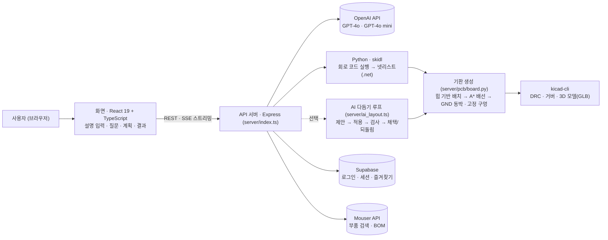

# SchemaForge 프로젝트 계획서 — 보완 항목

시스템 구조 · UI/UX 예시 · AI 활용방안 · 구체적인 일정 계획 · GitHub 주소.
화면 이미지는 같은 폴더의 `images/`에 있다 (2026-10-14, 저장소의 데모 회로로 실제 화면을 캡처).

---

## 1. 시스템 구조

사용자는 브라우저에서 회로를 말로 설명한다. 화면(React)은 서버(Express)에 요청하고, 서버가 AI 호출 · 회로 코드 실행 · 기판 생성 · KiCad 검사를 순서대로 돌리면서 진행 상황을 스트리밍(SSE)으로 돌려준다.

| 계층 | 구성 | 하는 일 |
|---|---|---|
| 화면 | React 19, TypeScript, Vite, SCSS, three.js | 설명 입력, 사양 질문, 설계 계획 확인, 회로도·기판 2D·3D 보기, 파일 내려받기 |
| API 서버 | Node.js, Express 5, TypeScript(tsx) | AI 호출, 생성 단계 스트리밍, Python·KiCad 실행, 인증 |
| 회로 | Python, skidl | AI가 만든 회로 코드를 실행해 KiCad 넷리스트를 만든다 |
| 기판 | Python (`placer.py`, `router.py`, `board.py`, `erc.py`) | 풋프린트 매핑, 배치, 2층 배선, 회로 점검 |
| 검사·출력 | KiCad 10 `kicad-cli` | 설계 규칙 검사(DRC), 거버, 3D 모델 |
| 저장 | Supabase | 로그인, 세션·대화 기록 저장 (없으면 메모리 저장) |
| 배포 | Docker (공식 KiCad 이미지 기반) + Railway | 서버 한 컨테이너에 Node · Python · KiCad를 함께 넣는다 |

**처리 흐름**
1. 설명 입력 → `/clarify` 빠진 사양(전압, 부품 형태 등)을 질문 → `/plan` 설계 계획
2. `/generate` AI가 skidl 회로 코드 생성 → 서버가 실행해 넷리스트 생성 (실패하면 오류를 넣어 1회 자동 수정) → 넷리스트 점검(ERC), 오류가 있으면 1회 자동 수정
3. `/generate_pcb_stream` 배치 → 배선 → 동박 → 검사를 단계마다 화면에 재생
4. `/generate_gerber` 거버 출력, `.net` · `.kicad_pcb` 내려받기

---

## 2. UI/UX 예시

**홈 — 설명 입력**

- 한 줄 설명을 쓰고 `회로 만들기`(Ctrl + Enter)를 누른다. 아래 예시 문장을 누르면 바로 채워진다
- 오른쪽 카드는 로그인 없이 열어 볼 수 있는 모터 드라이버 데모다. 수치(기판 36.7 × 36.4 mm, 배선 14/14, 비아 3, 트랙 72 mm)는 편집하지 않은 실제 출력이다

**홈 — 회로 종류와 내부 단계 안내**

- 설명이 막막한 사용자는 회로 종류(오디오 앰프, LED, 전원, 타이머, 센서, MCU 보드 등 11종)를 고르면 사양을 차례로 질문받는다
- "안에서 일어나는 일"에서 회로 → 배치 → 배선 → 검사 → 다듬기 다섯 단계와 쓰는 기술을 미리 보여 준다

**결과 — 회로도**

- 가운데: 부품과 넷이 색으로 구분된 회로도 (드래그로 이동, 더블클릭 값 편집)
- 왼쪽: AI 편집기 — "저항 하나 추가해 줘", "R1 값을 100k로 바꿔 줘"처럼 말로 수정
- 오른쪽: 사양과 부품 목록(BOM) / 위: `.net` 내려받기, SMD·THT 선택, `PCB 생성`

**결과 — 기판 2D · 3D**

- `PCB 생성`을 누르면 배치와 배선이 실제로 계산되는 과정을 재생하고, 끝나면 2D(KiCad 색)와 KiCad가 만든 3D 모델을 나란히 보여 준다
- 아래 줄: 배선 14/14, 비아 3, 트랙 72 mm, 기판 크기, DRC 오류 0, 미연결 0 — 결과를 숫자로 확인
- 오른쪽 위 `확인` 패널: 사람이 직접 봐야 할 항목(부품 핀 배열 등)을 따로 모아 준다

**UX에서 지킨 원칙**
- 계산을 꾸미지 않는다: 재생되는 화면은 실제 계산 결과 프레임이다
- AI가 정한 것과 검사가 확인한 것을 구분해 보여 준다: DRC·미연결은 숫자로, 사람이 확인할 것은 따로
- 키 없이도 체험할 수 있게 데모 회로 4개(`?demo=motor`, `led`, `ne555`, `relay`)

---

## 3. AI 활용방안

| 단계 | 모델 | AI가 하는 일 | AI 결과를 확인하는 방법 |
|---|---|---|---|
| 사양 질문 `/clarify` | GPT-4o mini | 설명에 빠진 사양(전원 전압, 부품 형태, 개수 등)을 질문으로 만든다 | 사용자가 답을 고른다 |
| 설계 계획 `/plan` | GPT-4o mini | 블록 단위 설계 계획을 만든다 | 사용자가 계획을 확인한 뒤 생성 |
| 회로 생성 `/generate` | GPT-4o | 설명·사양으로 skidl 회로 코드를 쓴다 | 서버가 코드를 **실행**해 넷리스트가 나와야 통과. 실패하면 오류 메시지를 넣어 1회 자동 수정. 넷리스트 점검 오류도 1회 고치되, 고친 코드가 실행되고 오류가 줄 때만 받아들인다 |
| 대화형 수정 `/chat_edit` | GPT-4o mini | "LED 빼 줘" 같은 말을 부품 추가·값 변경·연결 동작으로 바꾼다 | 바뀐 회로를 다시 그려 사용자가 확인 |
| 기판 다듬기 (선택) | 설정 가능 (`SF_AI_MODEL`) | 부품 이동·회전, 선 굵기 변경을 **제안만** 한다 | 코드가 적용 → 재배선 → KiCad DRC → 점수 비교. 나빠지거나 그대로면 되돌린다. 최대 3라운드 |

**원칙: AI는 제안하고, 판정은 코드와 검사가 한다.**
- 회로는 skidl 실행이 통과해야 넷리스트가 나온다. 넷리스트 점검(연결 안 된 핀 등)의 오류는 모델이 한 번 고치고, 코드가 오류 수를 비교해 받아들이거나 되돌린다. 남은 오류는 회로도 화면에 표시한다 (PCB 생성은 막지 않음)
- 기판은 KiCad DRC와 점수(DRC 오류 → 미배선 → 겹침 → 디커플링 커패시터 거리 → 좁은 전원선 → 선 길이 → 비아 → 트랙 길이)로 판정한다
- 모델 없이 판정 로직을 검사하는 스텁 모드(`SF_AI_STUB=1`)가 있어, API 비용 없이 "나쁜 제안은 되돌아온다"를 매번 확인한다

**확인된 효과 (2026-09 측정)**
- 릴레이 기판: 부하 전류가 흐르는 넷 6개가 전부 0.8 mm로 넓어짐 (좁은 전원선 6 → 0개), DRC 오류 0 유지
- 제안을 묶음(선 폭 / 배치)으로 나눠 판정한 뒤 같은 기판의 트랙 길이 105.08 → 90.11 mm
- NE555 기판 다듬기 시간 152.0 → 37.5초 (반복 제안 제거, DRC 처리 수정)

**앞으로 붙일 AI 활용**
- 부품 데이터시트 기반 핀 배열 확인 보조 — 지금 사람이 확인하는 항목(트랜지스터 핀 순서)을 줄이기
- 부품 값 타당성 점검 — 저항·커패시터 값이 회로 목적에 맞는지 계산식으로 검사하고, 모델은 설명만 맡기

---

## 4. 구체적인 일정 계획 (2026-10-14 ~ 12-15)

> 종강·발표 날짜는 강의 계획서 기준으로 조정한다. 아래는 주 단위 계획이고, 각 주의 "완료 기준"을 검사 스크립트나 실제 결과물로 확인한다.

| 주 | 기간 | 할 일 | 완료 기준 |
|---|---|---|---|
| 1 | 10-14 ~ 10-20 | 기판 2D·3D 화면 개선분 정리·반영. 데모 회로의 트랜지스터 핀 배열 문제(2N3904 SMD, 2N7002 THT) 수정 | 핀 배열 검사 항목 추가 후 기판 8개 검사 통과 |
| 2 | 10-21 ~ 10-27 | Railway 실제 배포 1회. 배포 서버에서 DRC · 거버 · 3D가 도는지 확인 | 배포 주소에서 데모 → 거버 내려받기 성공 |
| 3 | 10-28 ~ 11-03 | 로그인 후 전체 흐름(설명 → 질문 → 계획 → 회로 → PCB → 거버) 점검과 오류 수정 | 회로 종류 5개 이상으로 전체 흐름 통과 |
| 4 | 11-04 ~ 11-10 | 테스트 회로 확장: MCU 보드(ESP32), 전원 레귤레이터 | 검사 기판 8 → 12개, 전부 DRC 오류 0 |
| 5 | 11-11 ~ 11-17 | AI 다듬기 효과 측정: 테스트 회로 4종 × 3회 실행 | 채택률·지표 변화 표, README 갱신 |
| 6 | 11-18 ~ 11-24 | 실제 제작 1회: 데모 기판 1종을 거버로 PCB 주문 | 주문 완료, 거버 검토 기록 |
| 7 | 11-25 ~ 12-01 | 사용자 테스트: 3~5명이 직접 써 보고 막힌 곳 기록 | 피드백 목록과 수정 우선순위 |
| 8 | 12-02 ~ 12-08 | 기판 수령 후 조립·동작 확인, 피드백 반영 | 조립 사진·측정값, 수정 커밋 |
| 9 | 12-09 ~ 12-15 | 최종 정리: README, 시연 영상, 발표 자료 | 발표 자료 · 시연 영상 · 최종 README |

**지금까지 한 것 (2026-05 ~ 10)**
- 05-08: v0.4 첫 커밋 (회로 생성, 대화형 수정, 넷리스트)
- 09-11 ~ 09-12: 실제 KiCad 풋프린트, 힘 기반 배치, A* 배선, DRC·회로 점검 화면
- 09-12 ~ 09-17: AI 다듬기 루프와 판정 규칙, 3D 보기, 배포 이미지
- 09-18 ~ 09-22: README 작성, 자동 검사(CI) 추가

---

## 5. GitHub 주소

**https://github.com/gkdmsgus/SchemaForge** (Public)
- README.md에 프로젝트 개요(배경, 목표, 주요 기능, 화면, 시스템 구조, 기술 스택), 실행 방법, 검사 방법, 알려진 제약을 적었다
- 이 계획서는 저장소의 `docs/project-plan.md`
